# OptiForge 产品详细使用手册

> 正式名称：策擎·安全生产运筹优化平台
> 英文名称：OptiForge
> 简称：策擎
> 品牌语：让复杂约束，生成最优决策。

> 文档修订：2026.10.21-R4（源码修复及遗留项补齐）
>
> 适用代码：以 `4d81a3f952af97536918886fd9dc2dfe589e38a5` 为基线，加R3及R4源码修复；本版准确文件指纹及测试结果见 [R4遗留项修复与复验](manual-followup-closure-2026-10-21.md)。R2缺陷记录和R3验收保留为历史证据。

> R4 补充：修复水电参数中文提示，补齐新版本 Skill / Agent 真实执行回归，接通任务概览及结果 / 解释层的实际约束检查。独立复验使用前端15175、API18042，复用上一轮隔离验收态的独立副本；R3 原始结果保留。

> R4当前文件指纹及工程结果见 [遗留项修复与复验](manual-followup-closure-2026-10-21.md)，界面操作证据见 [R4独立代理复验](independent-ui-acceptance-followup-2026-10-21.md)。
>
> R3验证环境：2026-10-21，macOS arm64，React/Vite 前端，Python 3.12.14、Pyomo 6.10.1、HiGHS 1.15.1；修复后全新隔离运行态，前端 15174、API 18041，LLM 关闭。六条主教程已由未参与修复的独立测试代理通过界面验收，具体范围见 18.6。R4使用上文所列的独立副本环境。
>
> 部署说明同时提供原生与 Docker 方法；本轮没有重验 Windows、Docker、Ipopt 或真实 LLM 对话。其他版本的按钮、校验及历史迁移行为可能不同。

本手册面向业务操作人员、建模工程师、平台管理员和接口开发人员，说明从安装启动、准备数据、执行求解到查看结果的完整操作，以及组件、函数资产、Skill、Agent 和运维方法。首次使用建议先完成第 5 章的经济调度示例，再按工作需要阅读其他章节。

## 按任务阅读与验证范围

先选要完成的任务。主手册包含完整输入和核算方法；延伸资料只作补充，不能代替下面的步骤。

| 任务 | 从哪里开始 | 本轮验证到哪里 |
| --- | --- | --- |
| 使用已有模型计算 | [第 5 章](#5-最快上手从业务场景到优化结果) | 独立代理 UI 提交并复算目标 160300，平衡、边界及爬坡均通过 |
| 空白建立一维模型 | [8.2](#82-教程二从空白建立一维供电模型) | UI 建立、测试、发布、重开，目标 40 |
| 空白建立二维模型 | [8.3](#83-教程三从空白建立两机组两时段模型) | UI 录入成员、二维参数、测试、发布、重开，目标 17 |
| 创建组件并装入模型 | [12.1](#121-教程四创建组件并装配到模型) | 独立代理 UI 求解目标20、发布重开通过；见18.6 |
| 曲线参与求解并维护修订 | [12.2](#122-教程五创建费用曲线并绑定模型) | 独立代理 UI 验证r1目标40、r2目标55、应用更新和历史保留；见18.6 |
| 已发布模型接入 Skill / Agent | [14.4](#144-教程六把已发布模型接入-skill-和-agent) | 独立代理确认完整 Skill r1、Agent包启用 / 重开、真实Skill调用目标40；真实LLM对话未验证 |

组件默认值、参数映射、变量边界、Builder 转换公式执行和预览重复等问题已在源码修复。仍须按本文核对业务数值后发布。R2 失败证据见 [历史验证记录](user-manual-validation-2026-10-21.md)，本轮测试和独立代理界面验收见 [修复与验收记录](manual-repair-acceptance-2026-10-21.md)及 [18.6](#186-独立操作验收表)。

## 重要说明

本平台用于电力与能源场景的优化建模、求解、结果分析和辅助决策。平台输出的是优化建议和分析结果，不是自动控制指令；结果投入生产调度前，必须由具备业务权限的人员复核。

当前版本默认使用本地运行时存储，模型、任务和结果会写入项目数据目录。请在清理、迁移或重置运行环境前备份数据文件。

---

## 目录

1. [平台简介](#1-平台简介)
2. [角色与功能入口](#2-角色与功能入口)
3. [环境准备与启动](#3-环境准备与启动)
4. [界面基础操作](#4-界面基础操作)
5. [最快上手：从业务场景到优化结果](#5-最快上手从业务场景到优化结果)
6. [业务场景库](#6-业务场景库)
7. [模型资产中心](#7-模型资产中心)
8. [创建与维护模型：五步工作流](#8-创建与维护模型五步工作流)
9. [创建求解任务](#9-创建求解任务)
10. [任务调度中心](#10-任务调度中心)
11. [结果报告库](#11-结果报告库)
12. [组件资产与函数曲线](#12-组件资产与函数曲线)
13. [模型服务与在线调试](#13-模型服务与在线调试)
14. [Skill 服务中心](#14-skill-服务中心)
15. [Agent 工作台](#15-agent-工作台)
16. [求解环境与系统配置](#16-求解环境与系统配置)
17. [常见问题与故障处理](#17-常见问题与故障处理)
18. [推荐操作清单与能力边界](#18-推荐操作清单与能力边界)
19. [典型场景操作要点](#19-典型场景操作要点)
20. [数据备份与部署维护](#20-数据备份与部署维护)
21. [API 集成与高级功能](#21-api-集成与高级功能)
22. [术语与延伸资料](#22-术语与延伸资料)

---

## 1. 平台简介

平台将业务场景、模型资产、运行参数、求解任务和结果分析串成一个闭环：

~~~mermaid
flowchart LR
    A[选择业务场景] --> B[选择或创建模型]
    B --> C[填写运行参数]
    C --> D[提交求解任务]
    D --> E[监控求解过程]
    E --> F[查看结果报告]
    F --> G[人工复核与业务决策]
    G -. 需要调整 .-> C
~~~

平台主要支持以下工作：

- 管理电力调度、储能、风光储、热电联产、梯级水电、市场交易和算电协同等模型资产。
- 使用内置模板快速克隆模型，或通过五步工作流创建新模型。
- 使用通用线性 Builder、组件化 Builder 或模板 Builder 表达模型。
- 对模型的语义、公式、组件依赖、运行参数和求解器兼容性进行校验。
- 创建、监控、取消、重试和归档优化任务。
- 通过指标、曲线、业务解释、约束诊断和原始 JSON 查看结果。
- 使用模型服务、Skill 和 Agent 进行在线调用或自然语言交互。

当前代码包含 17 个内置模型模板；内核注册表有 27 个内置组件，组件资产清单还包含预置的自定义定义及用户资产，因此页面总数不必等于 27。具体可调用资产以发布状态、模型版本和运行环境为准。

### 1.1 求解器能力

| 问题或策略 | 默认求解器/处理方式 | 使用提示 |
| --- | --- | --- |
| LP | HiGHS | 适合连续线性模型 |
| MILP | HiGHS | 适合含整数变量的线性模型 |
| 一维 PWL | 按策略展开为 LP/MILP，使用 HiGHS | 严格相邻分段与连续凸组合的含义不同 |
| 二维 PWL | 凸包近似 LP 或三角剖分 MILP，使用 HiGHS | 精确三角剖分会增加整数规模 |
| McCormick | HiGHS + 线性松弛 | 需要合理的变量上下界 |
| 连续变量 NLP | Ipopt | 通常是局部最优，结果依赖初值、上下界和模型缩放 |
| MINLP | 当前保留能力，不作为生产级能力开放 | 建议改用 PWL 或 McCormick 线性化 |

---

## 2. 角色与功能入口

### 2.1 用户角色

| 角色 | 主要任务 | 推荐入口 |
| --- | --- | --- |
| 调度业务人员 | 选择场景、填写数据、提交任务、复核结果 | 业务场景、求解任务、结果分析、Agent 工作台 |
| 建模工程师 | 创建模型、维护公式、绑定组件和函数资产 | 模型资产、组件资产、函数与曲线、求解环境 |
| 平台管理员 | 维护字典、运行环境、Skill 和模型生命周期 | 系统配置、求解环境、Skill 服务、模型资产 |
| 集成开发人员 | 查看模型服务契约、在线调试和调用记录 | 模型服务、模型详情、Skill 服务 |

### 2.2 导航入口

| 页面 | 路径 | 用途 |
| --- | --- | --- |
| 首页 | `/` | 查看运行概况、最近任务、已发布模型和求解能力 |
| 业务场景 | `/scenarios` | 按业务问题选择模型或进入建模 |
| 模型资产 | `/models` | 管理模型版本、测试、发布、复制和调用入口 |
| 新建模型 | `/models/create` | 进入五步模型创建工作流 |
| 模型详情与草稿编辑 | `/models/:id`、`/models/:id/edit` | 查看或编辑实际 ID 对应的模型资产 |
| 求解任务 | `/tasks` | 创建、监控、取消、重试和删除任务记录 |
| 结果分析 | `/results` | 查看已完成任务的结果报告 |
| Agent 工作台 | `/agents` | 用业务语言描述优化需求并确认调用 |
| 模型服务 | `/services` | 查看已发布服务并在线调试 |
| 组件资产 | `/components` | 管理可复用组件、依赖和版本 |
| 函数与曲线 | `/functions` | 管理一维曲线和二维曲面函数资产 |
| Skill 服务 | `/skills` | 管理 Skill、Schema、Agent 绑定和调用记录 |
| 求解环境 | `/runtime` | 查看后端、HiGHS、Ipopt 和任务服务状态 |
| 系统配置 | `/settings` | 维护业务场景字典、组件字典、大模型配置等 |

### 2.3 业务视图与专家视图

顶部的“业务视图 / 专家视图”用于切换导航范围：

- 业务视图：显示首页、业务场景、模型资产、求解任务、结果分析、Agent 和模型服务。
- 专家视图：在业务功能基础上显示组件资产、函数与曲线、Skill、求解环境和系统配置。
- 在较窄屏幕上，视图切换位于左侧移动导航抽屉内。

视图切换只影响菜单显示，不会删除或修改已有模型、任务和结果。上述角色是推荐的操作分工；视图切换不能作为账户权限或审批授权的依据。模型详情和 Agent 活动面板另有各自的专家信息开关，与全局菜单视图分别控制不同区域。

---

## 3. 环境准备与启动

### 3.1 运行要求

本地运行需要 Python、Node.js、npm 及项目依赖。当前 Docker 环境使用 Python 3.12 和 Node.js 22，可作为本地环境选择的参考。

后端依赖包含 FastAPI、Pyomo、highspy 和 httpx。`requirements.txt` 不会安装 Ipopt 可执行文件；需要 NLP 时应另行准备 Ipopt，或使用包含该环境的 Docker 镜像。

以下命令从项目根目录开始执行。首次安装后，日常使用通常只需启动服务。

### 3.2 macOS 安装与一键启动

```bash
cd /Users/joiefu/Project/OPTIFORGE
python3 -m venv .venv-mac
./.venv-mac/bin/python -m pip install --upgrade pip
./.venv-mac/bin/python -m pip install -r requirements.txt
cd frontend
npm ci
cd ..
./start.sh
```

如脚本缺少执行权限，先执行 `chmod +x start.sh stop.sh`。Windows 复制来的 `.venv/` 不能直接在 macOS 使用，应创建本机 `.venv-mac/`。

启动脚本优先选择 `.venv-mac/bin/python`，其次选择 `.venv/bin/python`，再查找系统 Python。它以 `SERVICE_MODE=combined` 启动平台与 Agent，同时启动 Vite，并检查服务状态。

| 服务 | 默认地址 |
| --- | --- |
| React 开发前端 | `http://127.0.0.1:5173` |
| 后端 API | `http://127.0.0.1:8000/api` |
| 健康检查 | `http://127.0.0.1:8000/api/health` |
| 求解器状态 | `http://127.0.0.1:8000/api/solvers/status` |
| 交互式 API 文档 | `http://127.0.0.1:8000/docs` |

Finder 中也可双击 `启动OPTIFORGE.command` 与 `停止OPTIFORGE.command`。首次运行如被 macOS 拦截，可右键文件选择“打开”。

停止脚本启动的服务：

```bash
./stop.sh
```

其他启动选项：

```bash
./start.sh --no-browser
./start.sh --api-port 8001 --frontend-port 5174
```

修改端口后按脚本打印的地址访问。Linux 同样可使用 shell 脚本，但需要创建当前操作系统自己的虚拟环境。

### 3.3 Windows 安装与手工启动

在 PowerShell 中安装依赖：

```powershell
python -m venv .venv
.\.venv\Scripts\python.exe -m pip install -r requirements.txt
cd frontend
npm ci
cd ..
```

终端一启动后端：

```powershell
$env:SERVICE_MODE='combined'
$env:PORT='8000'
$env:OPTIMIZATION_PLATFORM_BASE_URL='http://127.0.0.1:8000'
$env:AGENT_PLATFORM_ACCESS_MODE='in_process'
$env:AGENT_ALLOW_IN_PROCESS_PLATFORM_FALLBACK='false'
.\.venv\Scripts\python.exe server.py
```

终端二启动前端：

```powershell
cd frontend
$env:VITE_API_BASE_URL='http://127.0.0.1:8000'
npm run dev
```

打开 `http://127.0.0.1:5173`。手工运行的服务在相应终端按 `Ctrl+C` 停止。

### 3.4 macOS 或 Linux 手工启动

终端一：

```bash
SERVICE_MODE=combined PORT=8000 \
OPTIMIZATION_PLATFORM_BASE_URL=http://127.0.0.1:8000 \
AGENT_PLATFORM_ACCESS_MODE=in_process \
AGENT_ALLOW_IN_PROCESS_PLATFORM_FALLBACK=false \
./.venv-mac/bin/python server.py
```

终端二：

```bash
cd frontend
VITE_API_BASE_URL=http://127.0.0.1:8000 npm run dev
```

Linux 使用自己创建的虚拟环境路径。

**端口说明：**一键脚本默认设置后端为 8000；单独运行 `python server.py` 且未设置 `PORT` 时，`combined/platform` 默认使用 8090，`agent` 默认使用 8091。按示例明确设置 `PORT`，避免前后端地址不一致。

### 3.5 配置文件与服务模式

`frontend/.env.example` 提供前端 API 地址示例。需要持久使用自定义地址时，可复制为 `frontend/.env` 并修改 `VITE_API_BASE_URL`。修改后重新启动 Vite；生产构建则需要重新构建。

根目录 `.env.example` 是后端配置参考。当前 shell 脚本和 `server.py` 没有自动加载根目录 `.env` 的步骤，后端变量需要由启动进程环境或部署配置传入。

| `SERVICE_MODE` | 使用方式 |
| --- | --- |
| `combined` | 同一后端提供平台与 Agent，适合本地完整使用 |
| `platform` | 提供模型、任务、结果和 API Skill 等平台能力，不提供工作台需要的 Agent API |
| `agent` | 只部署 Agent 侧能力，需要连接独立平台服务 |

本地单体模式使用 `AGENT_PLATFORM_ACCESS_MODE=in_process`。分体部署时，需要将 `OPTIMIZATION_PLATFORM_BASE_URL` 指向平台后端，并配置对应访问方式。

### 3.6 生产托管模式

```bash
cd frontend
npm ci
npm run build
cd ..
SERVICE_MODE=combined PORT=8000 ./.venv-mac/bin/python server.py
```

访问 `http://127.0.0.1:8000/`。FastAPI 托管 `frontend/dist`，前端与 `/api/*` 由同一服务提供，并处理 React 子路由刷新。Windows 执行相同构建命令，通过 PowerShell 设置环境变量和 Python 路径。

### 3.7 Docker 运行

```bash
docker compose build
docker compose up -d
docker compose ps
```

默认访问 `http://127.0.0.1:18000`。查看日志和停止：

```bash
docker compose logs --tail=100 backend
docker compose down
```

Docker 的运行数据挂载到 `docker-data/`，生成的 Agent 包在 `docker-data/agent_skills/`。首次启动会复制缺失的内置 Agent 包，已有包不会被直接覆盖。Compose 默认关闭 LLM，使用 Agent 智能对话需要继续完成大模型配置。

Docker 启动会先检查求解环境。排查 NLP 时执行：

```bash
docker compose exec backend python scripts/check_nlp_solver.py
```

### 3.8 首次检查与数据位置

```bash
curl http://127.0.0.1:8000/api/health
curl http://127.0.0.1:8000/api/solvers/status
curl http://127.0.0.1:8000/api/agent/status
```

PowerShell 可使用 `Invoke-RestMethod` 请求相同地址。Docker 把端口换成 18000。

检查要点：健康接口返回 `ok: true`，`pyomo_installed`、`highspy_installed` 为 `true`；普通 LP/MILP 需要 `highs.available: true`；NLP 还需检查 Ipopt 与 Pyomo 的可用性。Agent API 可连接后，自然语言能力仍取决于 LLM 配置和 Function Calling 验证。

求解器接口可能因 Ipopt 缺失返回整体异常状态。应分别检查 HiGHS 与 Ipopt，不能据此认为全部求解能力不可用。

原生默认运行数据为 `data/runtime_store.json`，Agent 包默认在 `agent_skills/`。当前运行时存储会在加载历史文件时按需要规范化结构。升级或迁移前备份原文件；详细方法见第 20 章。

---

## 4. 界面基础操作

### 4.1 顶部状态栏

顶部状态区域会显示后端连接和求解器状态：

- “平台在线 · HiGHS”：后端可连接，默认线性求解器可用。
- “平台连接异常”：前端无法获取健康检查结果。
- “状态待检查”：页面正在初始化或等待接口返回。
- 点击状态标记可查看后端、求解器和运行环境明细。

右上角还包含：

- 全局搜索：搜索模型、场景、组件、函数资产、任务或报告；Windows/Linux 可使用 `Ctrl+K`，macOS 可使用 `Command+K`。
- 任务消息：查看失败、无解或超时任务提醒。
- 业务视图 / 专家视图切换。
- “新建模型”快捷按钮。

首页可查看运行中与异常任务、已发布模型、近 7 天任务、最近任务及求解能力，并切换 7/14/30 天趋势。进度和统计来自实际任务记录；把任务消息标为已处理只改变通知处理标记，不会改变任务本身的状态。

### 4.2 侧栏与响应式布局

- 桌面端可折叠侧栏，折叠状态会保存到浏览器本地。
- 窄屏设备会将侧栏收进移动导航抽屉。
- 页面中的抽屉、弹窗和表格可横向滚动；提交前请确认没有被折叠区域隐藏的校验提示。

### 4.3 状态标签的基本含义

常见模型状态：

- 草稿：可编辑，尚未完成正式发布。
- 试运行：已通过测试，可按明确的 `model_id` 调试，但不会作为正式生产服务版本。
- 已发布：正式可调用版本，可进入任务、模型服务、Skill 或 Agent 调用链路。
- 已下线：保留历史记录，不再接受新的正式调用。

常见任务状态：

- `PENDING` / `QUEUED`：排队等待。
- `VALIDATING`：校验输入参数。
- `BUILDING_MODEL`：构建求解模型。
- `SOLVING`：调用求解器。
- `RUNNING`：执行中兼容状态。
- `FORMATTING_RESULT`：整理结果和业务解释。
- `SUCCESS`：求解成功，可查看结果。
- `FAILED`：执行失败。
- `INFEASIBLE`：模型无可行解。
- `TIMEOUT`：超过允许的求解时间。
- `CANCELLED`：任务被取消。
- `INTERRUPTED`：中断记录，部分恢复路径可能出现。

---

<a id="5-最快上手从业务场景到优化结果"></a>

## 5. 最快上手：从业务场景到优化结果

本示例使用“经济调度”内置模型，在 4 个时段内为 3 台机组分配出力。需要 HiGHS，无需配置大模型或 Ipopt。

### 5.1 选择已发布模型

1. 打开“求解任务”，点击“创建任务”。
2. 搜索并选择“经济调度”的已发布版本。
3. 核对模型、时间维度和默认求解器。
4. 点击“下一步”。

若列表中没有该模型，到“模型资产”检查是否已下线或只有草稿、试运行版本。需要新建时，从 `economic_dispatch` 模板创建，测试并发布后再运行。

也可以先在业务场景库了解关联模型；当前场景卡片的主要操作是进入建模，直接计算使用任务中心。

### 5.2 填写样例数据

将调度周期设为 4 点。可以保留默认样例，或展开“高级 JSON 输入”，粘贴以下业务参数后点击“导入并合并”：

```json
{
  "unit": ["U1", "U2", "U3"],
  "load_forecast": [160, 190, 175, 150],
  "unit_min_output": {"U1": 30, "U2": 20, "U3": 10},
  "unit_max_output": {"U1": 120, "U2": 90, "U3": 70},
  "fuel_cost": {"U1": 220, "U2": 260, "U3": 360},
  "ramp_up_limit": {"U1": 80, "U2": 60, "U3": 50},
  "ramp_down_limit": {"U1": 80, "U2": 60, "U3": 50},
  "initial_unit_output": {"U1": 80, "U2": 50, "U3": 30}
}
```

`load_forecast` 按 4 个时段排列，带 `U1/U2/U3` 的对象按机组编码填写。调度周期在页面设置，不必在业务 JSON 中添加 `time` 等系统时间字段。真实使用时按页面显示的单位和口径替换数据。

### 5.3 检查并提交

1. 查看必填完成度和参数问题，确认没有阻断。
2. 进入“检查并提交”。
3. 核对模型、4 点调度周期、求解器和最终提交预览。
4. 点击“提交求解并打开详情”，记录任务编号。
5. 等待任务经历校验、建模、求解和结果整理。

### 5.4 查看并验证结果

状态为 `SUCCESS` 后，打开任务“优化结果”查看变量，再到“结果分析”核对终止条件、问题类型和输入。使用上述输入及对应内置经济调度模型时，目标值为 **160300**。本轮独立代理通过界面提交任务 `OPT-FF2815CF71`，得到相同结果，并复算平衡、出力边界及初始 / 后续爬坡。

本例每时段按 **1 小时**、线性燃料成本元/MWh 核算。内置目标使用逐时成本系数；下表以 1 小时解释它的数值，不能据此推断任意粒度自动正确折算。要写半小时时段的自定义目标，按 8.2 显式乘 delta_t。

| 时段 | U1，MW | U2，MW | U3，MW | 总出力 / 负荷 | 本时段费用，元 |
| --- | --- | --- | --- | --- | --- |
| 0 | 120 | 30 | 10 | 160 / 160 | `120×220+30×260+10×360=37800` |
| 1 | 120 | 60 | 10 | 190 / 190 | 45600 |
| 2 | 120 | 45 | 10 | 175 / 175 | 41700 |
| 3 | 120 | 20 | 10 | 150 / 150 | 35200 |
| 合计 | — | — | — | — | **160300** |

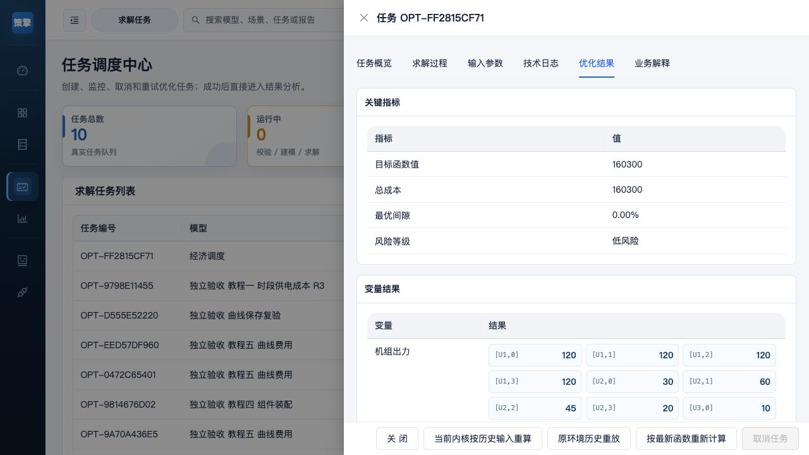

独立核对一次：U1 上限 120、U3 下限 10；U2 在 20～90 内。初始出力 `[80,50,30]` 到第一时段的变化为 `[+40,-20,-20]`，均未超出各机组爬坡限值；后续 U2 变化 `+30,-15,-25` 同样满足限值。四个平衡残差应为 0。

小例复算可用绝对误差 `1e-6` 作为定位差异的参考；真实模型采用业务与求解配置认可的容差。显示被四舍五入时查看原始数值。若没有约束检查明细，应按上表手算并注明“缺少系统约束明细”，不能写成“所有约束已由平台验证”。

### 5.5 调整数据再次计算

例如将负荷改为 `[170, 200, 180, 160]`：重新创建任务、选择同一模型、修改负荷后提交。两次计算保留不同任务记录，便于追溯输入与结果。

需要复用数据时，可使用“从历史任务载入”，选择同模型兼容的成功记录，并明确是仅填空值还是覆盖当前参数。

---

## 6. 业务场景库

入口：`/scenarios`。场景卡片显示说明、模型资产数、已发布和试运行模型数及关联模型。场景状态来自系统字典，推荐展示来自该场景下实际可运行的已发布模型。

### 6.1 使用场景与关联模型

1. 按场景名称或场景状态筛选。
2. 核对关联模型的名称、状态和能力。
3. 需要建模时，点击“进入建模”或“创建空白模型”。
4. 需要直接计算时，到“求解任务”选择该模型的已发布版本。

“暂无可用业务场景”通常表示字典没有可用条目。到“系统配置”启用场景并保存，系统不会回退到静态场景目录。

### 6.2 当前内置模板

当前代码包含 17 个模板。存在模板不等于模型已经作为正式服务启用，部分模板初始状态为试运行。

| 模板编码 | 业务用途 | 重点 |
| --- | --- | --- |
| `unit_commitment_day_ahead` | 日前机组组合 | 启停、出力、备用与负荷平衡 |
| `economic_dispatch` | 经济调度 | 已知机组条件下的经济出力分配 |
| `storage_dispatch` | 储能充放电 | 电价、功率、效率与状态 |
| `renewable_storage_dispatch` | 风光储协同 | 新能源消纳、弃电和储能 |
| `chp_dispatch` | 热电协同 | 电负荷、热负荷与热电耦合 |
| `cascade_hydro_dispatch` | 梯级水电日前调度 | 水量平衡、检修、负荷与期末库容 |
| `cascade_hydro_dispatch_v1` | 水电 PWL 模型 | 一维和二维函数资产的 MILP 路径 |
| `pv_storage_capacity_planning` | 光伏储能容量配置 | 当前样例为固定 4 点时间契约 |
| `pv_storage_day_ahead_dispatch` | 光储日前调度 | 消纳、充放电和并网计划 |
| `pv_storage_intraday_dispatch` | 光储日内调度 | 当前 SOC、最新预测与剩余计划 |
| `pv_storage_dispatch_v2` | 光储一体化 V2 | 互斥、偏差考核与收益成本 |
| `pv_storage_day_ahead_dispatch_v2` | 光储日前 V2 | 偏差成本和 SOC 终值 |
| `pv_storage_intraday_dispatch_v2` | 光储日内滚动 V2 | 多窗口计算使用滚动服务 |
| `nonlinear_hydro_power_demo` | 水电 NLP 试点 | 固定 3 点，需要 Ipopt |
| `contract_spot_exposure_v1` | 合约分解与现货暴露 | 固定 96 点交易数据 |
| `retail_da_spot_bidding_v1` | 售电公司日前申报 | 固定 96 点，包含储能和可调负荷 |
| `compute_power_coordination_day_ahead_v1` | 智算园区算电协同 | 固定 24 点，单次 MILP 联合优化 |

### 6.3 模板选择原则

按业务目标选择后，继续检查时间契约、输入单位、约束和输出口径。名称相近的 V1/V2 版本不应直接套用整份参数 JSON，应读取所选模型的 Schema。

简单储能与光储 V2 的 SOC、容量和时序字段可能采用不同表达方式。以当前版本的字段类型、单位和默认样例为准。

---

## 7. 模型资产中心

入口：`/models`。

### 7.1 查看和筛选模型

模型列表支持按以下条件筛选：

- 建模方式：通用线性 Builder、组件化 Builder、模板 Builder。
- 问题类型：LP、MILP、NLP 等。
- 模型状态：草稿、试运行、已发布、已下线等。
- 业务场景。

列表中的关键信息包括模型名称、编码、版本、场景、问题类型、求解器、状态和更新时间。

### 7.2 从内置模板克隆

1. 点击“从模板克隆”。
2. 搜索并选择一个内置模板。
3. 确认模板的名称、问题类型和求解器。
4. 点击确认克隆。
5. 克隆完成后进入模型详情或继续进入模型创建流程完善。

完整模板及用途见第 6.2 节。克隆形成独立资产，仍需按新资产自身状态完成测试与发布。

### 7.3 查看模型详情

点击“查看”后可查看：

- 基本信息：名称、编码、场景、状态、版本和发布时间。
- 模型语义：集合、参数、变量及时间维度契约。
- `generic_spec`：通用模型结构、约束和目标项。
- 组件装配：组件清单、依赖和参数绑定。
- 运行参数：输入 Schema、默认值和输入/输出契约。
- 模型说明：业务口径、建模方法和能力边界。
- 发布治理：测试、dry-run、发布信息、警告和版本治理。
- 调用记录：近期模型调用和任务记录。

可以在详情中切换“业务视图”和“专家视图”。

### 7.4 模型生命周期

| 状态 | 含义 | 常用操作 |
| --- | --- | --- |
| `developing` 草稿 | 可以直接编辑 | 保存、校验和测试 |
| `trial` 试运行 | 已形成测试验收基线 | 正式发布；首次发布前可退回草稿 |
| `published` 已发布 | 正式可调用版本 | 验证运行、创建新版本或下线 |
| `offline` 已下线 | 保留历史，不接受新正式调用 | 按条件恢复或创建新版本 |
| `publish_failed` 发布失败 | 发布未通过 | 修复并重新测试 |

推荐流程：草稿 → 保存和校验 → 测试运行 → 试运行 → 正式发布。

试运行版本仅允许按明确 `model_id` 验收调试，不进入正式 `model_code` 或 Skill 自动路由。普通任务向导主要提供已发布模型。

### 7.5 修改与升级版本

- 草稿：使用“编辑草稿”。
- 未正式发布过的试运行版本：使用“退回草稿并修改”，旧测试凭据会清除。
- 已发布、已下线或发布过的历史版本：使用“创建新版本并修改”。
- 需要独立业务模型：使用“复制为独立模型”，按独立编码维护。

`model_code` 用于识别模型族，`model_id` 用于指定具体资产版本。同编码新正式版本发布后，原正式服务版本会自动下线；恢复历史版本同样影响当前正式版本。

### 7.6 测试与发布一致性

测试后再次修改内容，会使旧测试失效，需要重新保存并测试。正式发布会校验当前内容与试运行基线一致，不会重复执行求解测试。

已发布模型的“验证运行（状态不变）”成功后仍保持已发布。下线版本只有在内容与有效测试一致等条件满足时，才可直接恢复；否则需重新测试进入试运行。

---

<a id="8-创建与维护模型五步工作流"></a>

## 8. 创建与维护模型：五步工作流

入口：`/models/create`，或从模型资产中心点击“创建模型”。

模型创建页底部提供“上一步”“下一步”“校验模型”“保存草稿”和“发布模型”等操作。页面底部状态会提示当前草稿是否已保存、是否存在阻断项以及最近测试是否仍然有效。

### 8.1 先选择建模路径

| 你现在有什么、要做什么 | 入口与选择 | 得到的资产 | 对已有调用的影响 |
| --- | --- | --- | --- |
| 只有业务方程，例如出力上限和成本最小 | 新建模型 → 空白创建 → 通用线性 Builder | 新编码、新模型族的草稿 | 发布前不开放正式调用 |
| 已有可复用组件，要装配其接口、约束和目标项 | 空白创建 → 组件化 Builder | 新模型族，绑定组件定义 | 组件加入不等于绑定与求解通过，见第 12 章 |
| 内置场景与业务规则基本一致 | 从模板创建 → 选择模板，保留模板带入的建模模式 | 模板派生的新资产 | 不修改内置模板；检查带入的数据和所有约束 |
| 已发布模型要延续版本升级 | 模型详情 → 创建新版本并修改 | 同 `model_code` 的新 `model_id` | 新版发布后，按编码调用切到新版；旧固定 ID / 固定 Skill 保留原绑定 |
| 想另做一个业务方案、单独维护 | 模型详情 → 复制为独立模型 | 新编码、新模型族 | 原模型正式入口继续使用原版本 |
| 只改这一次的负荷、价格等数据 | 求解任务 → 创建任务 | 新任务，模型定义不变 | 不需要创建模型新版本 |

例如“机组出力不能超过最大容量”只有一条线性关系，先用通用线性 Builder 写 `p[u,t] <= cap[u,t]` 最容易核对。准备把它复用于很多模型时，再抽成组件。选模板会带入集合、参数、变量、组件、公式及默认运行数据，不能只看名称。

切换到组件化 Builder 后，模型自有的启用 DSL 约束和目标会与组件共同进入求解；停用 / 仅预览公式不参与。组件自己的生成公式由组件执行，不重复加入。转换后必须重新编译、保存、测试，并按第 12 章核算需求与费用。已有正式模型先“复制为独立模型”再试，不在旧测试凭据上直接发布。

创建页会自动保存。每次新增对象后，关闭弹窗并等待顶部“已保存”，再进入下一步；底部“待自动保存 / 本机恢复副本”不能代替服务端已保存。保存后的地址含本次草稿 ID，记下地址便于重开。

<a id="82-教程二从空白建立一维供电模型"></a>

### 8.2 教程二：从空白建立一维供电模型

**目标与前置条件。**两个半小时时段的需求分别为 10、20 MW，成本分别为 2、3 元/MWh，供电量不低于需求，最小化总费用。HiGHS 可用即可，无需组件、函数资产、LLM 或 Ipopt。完成后得到独立的已发布模型，最优出力 `[10,20]`，费用 **40 元**。

#### A. 基础信息与时间集合

1. 模型资产 → 新建模型，选“空白创建”。业务场景选“经济负荷分配”，建模模式选“通用线性 Builder”。名称填“手册教程一 时段供电成本”，模型编码可保留系统生成值。建模骨架保留默认“调度优化”。
2. 点击“保存草稿”，看到“已保存”再点“下一步”。
3. 第二步“模型语义”→“时间维度”：打开“是否启用时间维度”；策略选“固定时段”；默认 horizon 填 `2`，时间粒度填 `30` 分钟，核对 `delta_t=0.5`；关闭“使用状态时点集合”。
4. “集合”区应有 `time`、显示 `2 项`。点“编辑 时间点”，核对实际成员为 `[0,1]` 后保存。这里的数字是数学索引，30 分钟是时段长度，两者不能互换。

#### B. 定义参数与变量

在第二步点击“新增参数”，每次填一行并保存。**维度是文本输入框**，填写集合编码；标量维度留空。默认值输入合法 JSON，不加外层引号。以下三个参数保持“运行时注入”“运行必填”打开；示例值和说明可以留空。

| 编码 | 名称 | 维度栏 | 默认值栏 | 单位 |
| --- | --- | --- | --- | --- |
| `demand` | 时段需求 | `time` | `[10,20]` | MW |
| `cost` | 单位供电成本 | `time` | `[2,3]` | 元/MWh |
| `delta_t` | 每时段小时数 | 留空 | `0.5` | h |

时间配置会生成运行时的 `delta_t`；这里声明同名标量，是为了让公式编辑器认识这个符号。它应与时间摘要的 0.5 一致，不能用另一个时长重复折算。

点击“新增变量”，填编码 `p`、名称“供给功率”、类型“连续变量”、维度/索引 `time`、下界 `0`、上界 `100`、单位 `MW`，保存。该变量由求解器计算，不在运行参数中填写。

**进入下一步前应看到：**集合 1 个、真实成员 `[0,1]`；参数 3 个；变量 1 个、索引 `time`，对应 `p[0]`、`p[1]` 两个决策值。

#### C. 公式与索引推断

1. 第三步“数学展开”→“新增约束公式”，名称填“满足时段需求”。在 DSL 编辑区完整粘贴：

~~~text
p[t] >= demand[t]
~~~

2. 保持“参与求解”和“严格校验”，点“后端编译与展开”。本例会出现 **“已推断索引 t 映射到集合 time，保存前请确认。”** 检查变量和参数都声明在 `time` 上，再点“应用公式”。
3. 本版本在这条路径中通过编译器推断别名，**没有要求用户另找一个手工填写 `t→time` 的独立输入框**。提示有歧义或推断失败时，返回第二步修正维度，再重新编译；不要把集合编码 `time` 改成 `t`。
4. 点“新增目标函数”，名称填“半小时供电费用”，方向选“最小化”，目标权重填 `1`，DSL 填：

~~~text
sum(cost[t] * p[t] * delta_t for t in time)
~~~

5. 同样先“后端编译与展开”，再“应用公式”。最后点“编译模型（后端权威）”，应出现 `generic_spec 权威编译成功`，点“知道了”。

`>=` 允许多供电；本例成本为正，最优解自然取需求下界。如果业务要求精确平衡，应写 `p[t] == demand[t]`，不要依赖成本把不平衡“压回去”。`t` 是约束自由索引，意图是对两个时段分别生成约束；目标中的 `t` 则由 `for t in time` 在求和内部定义。

**检查展开数量。**本例约束应展开 2 条、求和包含 2 项。编译器会消除旧草稿中重复的 `time→time` 与 `t→time` 轴；真正使用的 `i,j` 两个索引即使同属一集合仍保留。显示数量与实际成员不符时，重新编译并核对 scope，不靠手改数量通过验收。

![图 8-1：独立代理编译 p[t]≥demand[t]，time 两个成员对应两条约束；绿色区域显示 t→time 推断。](manual-assets/2026-10-21-repair/independent/01-1d-constraint-2.jpg)

#### D. 填入本次测试数据

第四步“运行参数”，展开“高级调试：JSON 导入 / 运行参数结构预览”，在“运行参数 JSON”填入**业务参数对象**：

~~~json
{
  "demand": [10,20],
  "cost": [2,3],
  "delta_t": 0.5
}
~~~

可直接使用 [一维输入文件](manual-assets/2026-10-21/tutorial-1d-input.json) 中的同一对象。点击“导入并校验”。检查运行参数结构预览包含 `demand=[10,20]`、`cost=[2,3]`，时间摘要为 2 点、30 分钟、0.5 小时。`delta_t` 可能在系统时间区域显示，而不在普通参数表重复显示。若导入后表格和预览未变化，先不要离开；可逐项修改当前值，再按 Enter 或移出输入框提交，确认预览已变化。保存草稿并等待“已保存”。

模型参数定义声明“这个量叫什么、维度和单位是什么”；本次数据给它具体值。默认值用于未显式填写时的回退；示例值用于展示和“填充示例”，不应视为已确认的业务数据；当前值是此次提交采用的值。进入检查页前，以最终参数预览为准。

#### E. 测试、复算、发布和重开

1. 第五步“校验发布”，点击“校验模型”，应无阻断项。点击内容区下方的“测试运行”（步骤内导航也有同名入口，真正执行按钮位于诊断内容下方）。
2. 记录 `OPT-...` 任务编号。页面先显示校验、建模等状态，最终应为 `SUCCESS 100%`，底部“最近测试通过”。
3. 到“求解任务”→该任务→“优化结果”，逐个检查：

| 时段 t | demand，MW | p，MW | cost，元/MWh | 时长，h | 费用，元 | `p-demand` |
| --- | --- | --- | --- | --- | --- | --- |
| 0 | 10 | 10 | 2 | 0.5 | 10 | 0 |
| 1 | 20 | 20 | 3 | 0.5 | 30 | 0 |
| 合计 | — | — | — | — | **40** | — |

4. 检查上下界 `0≤p≤100`、终止条件 `optimal`、Gap 0。`MW × h = MWh`；若把时长漏掉会得到 80，不能把这个差异当作显示单位问题。
5. 返回同一草稿的第五步，点击“发布模型”。模型详情应显示“已发布”、具体模型 ID、编码及 2 点时间契约。关闭后从资产列表按名称重开，核对 ID 与公式。
6. 此后只改运行值，到任务中心建新任务；要改公式，使用“创建新版本并修改”。测试后再改任何内容，需要重新保存和测试。

本轮实测模型 `MODEL-FF80294E`、任务 `OPT-289B6A64F1`。这些是验证实例编号；用户新建时会生成自己的编号。

![图 8-2：任务优化结果中目标值 40，p[0]=10、p[1]=20。](manual-assets/2026-10-21-repair/independent/09-1d-result-40.jpg)

**异常恢复。**参数少一个点时回第四步补成两个数；公式找不到 `demand` 时回第二步核对编码和维度；发布按钮不可用时先检查是否保存后重测。若 `SUCCESS` 但变量不满足上表，保留输入、公式和任务编号，按 17.11 的“结果不符合业务”处理。

<a id="83-教程三从空白建立两机组两时段模型"></a>

### 8.3 教程三：从空白建立两机组两时段模型

**目标。**在每个半小时内用两台机组满足需求，较便宜的 U1 尽量多发。独立新建通用线性模型，名称“手册教程二 两机组两时段”，场景、时间配置、保存顺序与 8.2 相同；不要在一维模型上覆盖编码。预期目标 **17 元**。

#### A. 创建真实机组成员

第二步“模型语义”→“新增集合”，填编码 `unit`、名称“机组”、结构类型“业务集合”、来源“运行时注入”、默认规模 `2`，在 **“集合成员（JSON 数组）”** 填：

~~~json
["U1","U2"]
~~~

点“保存”。卡片应显示 `2 项`，再次点“编辑 机组”可查看成员。**默认规模只描述规模，不能生成 U1、U2，也不能替代成员。**本版本运行时来源同样要求建模时提供用于测试的代表成员；没有“填数量就自动建立机组”的规则。

| 错误成员输入 | 保存时反馈 | 正确修改 |
| --- | --- | --- |
| `[]` 或只填默认规模 | `集合必须包含非空字符串或有限数字成员` | 在成员栏填 `["U1","U2"]` |
| `["U1","U1"]`、`["U1",""]` | `集合成员不得为空或重复` | 去重并补上真实机组编码 |
| `U1,U2` | JSON 解析错误，不能保存 | 用方括号和双引号组成 JSON 数组 |

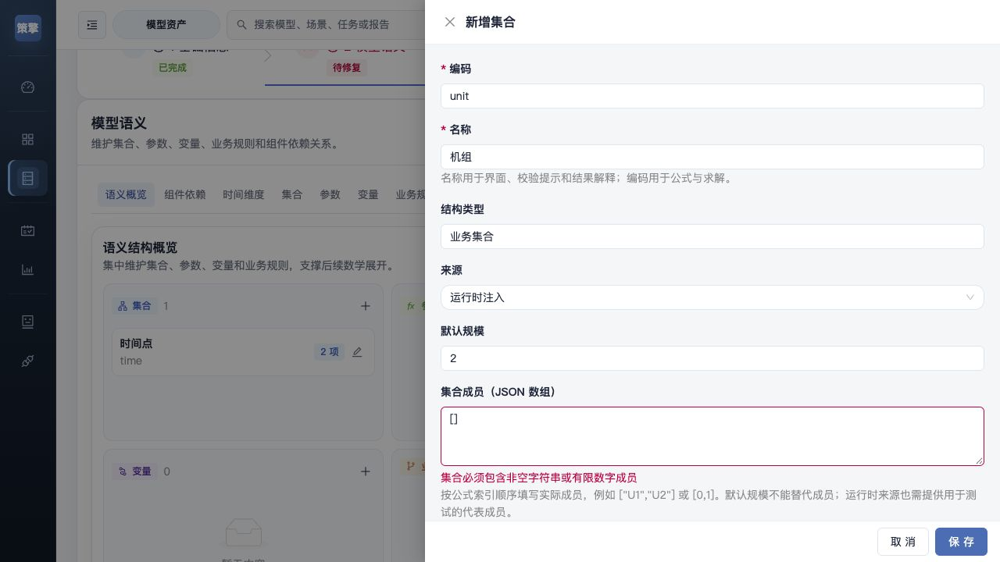


来源的作用与边界：

| 来源 | 建模时填写 | 本次运行如何取得 | 不填写的后果 |
| --- | --- | --- | --- |
| 运行时注入 | 真实代表成员；参数定义及维度 | 每次运行提供或使用已声明默认值 | 集合空、缺必填数据会阻断 |
| 静态参数 | 固定成员 / 默认数值 | 随模型版本保存 | 改定义后需重新测试；不应把变化数据长期固化 |
| 业务台账 | 台账口径、成员和实际代表数据 | 必须有实际接入或显式提供的数据 | 只选择来源不会连接业务系统，也不会自动拉数 |
| 系统生成 | 由平台管理的时间契约等 | 例如 time 自动为 `[0,1]` | 自定义集合选此来源不会凭空生成业务成员 |

这四种来源不能改变实际数据的业务含义，选择“台账”也不是数据新鲜度证明。

#### B. 定义二维数据与变量

第二步新增以下参数，来源“运行时注入”、运行必填打开；维度逐字填写，逗号顺序决定轴顺序。

| 编码与名称 | 维度栏 | 默认值栏 | 单位 | 公式实际取值示例 |
| --- | --- | --- | --- | --- |
| `demand` 时段需求 | `time` | `[6,8]` | MW | `demand[1]=8` |
| `cost` 机组成本 | `unit` | `{"U1":2,"U2":3}` | 元/MWh | `cost["U2"]=3` |
| `cap` 可用容量 | `unit,time` | `{"U1":[4,4],"U2":[4,6]}` | MW | `cap["U2",1]=6` |
| `delta_t` 每时段小时数 | 留空 | `0.5` | h | 所有时段同为 0.5 |

参数建模弹窗的维度栏填 `unit,time`，不是中文名称“机组,时间”，也不是索引别名 `u,t`。运行数据按集合编码对应；公式再用 `u`、`t` 表示其中的成员。

`cap` 的对应关系必须是：

| 第一轴 unit / 第二轴 time | 0 | 1 |
| --- | --- | --- |
| U1 | 4 | 4 |
| U2 | 4 | 6 |

本例实际验证的是“第一层按机组键映射，第二层按时间顺序数组”的结构。U2 数组的第一个数是 `cap["U2",0]`，第二个是 `cap["U2",1]`。后续任务页的纯值矩阵按行 U1/U2、列 0/1 填入；不要转置。其他参数允许的 dict / array 结构看各自契约的“格式与轴顺序”，本例不意味着任意参数都可任意替换格式。

新增变量：编码 `p`、名称“机组出力”、连续变量、维度/索引 `unit,time`、下界 `0`、上界 `10`、单位 MW。

**下一步前检查：**`unit=["U1","U2"]`、`time=[0,1]`；`p` 是 `unit × time`，共有四个组合：`p["U1",0]`、`p["U1",1]`、`p["U2",0]`、`p["U2",1]`。变量卡片的“1 个变量”是变量定义数量，不是只有一个决策值。

#### C. 求和约束和目标

第三步按 8.2 的“新增—后端编译与展开—应用公式”逐条录入，保持参与求解、严格边界：

| 名称 | DSL | 意图 |
| --- | --- | --- |
| 逐时负荷平衡 | `sum(p[u,t] for u in unit) == demand[t]` | 每个时段一条，共 2 条 |
| 可用容量上限 | `p[u,t] <= cap[u,t]` | 每个机组、每个时段一条，共 4 条 |
| 总供电费用 | `sum(cost[u] * p[u,t] * delta_t for u in unit for t in time)` | 最小化、权重 1，一个标量目标 |

第一条的 `u` 在 sum 内定义，只对机组求和；自由索引 `t` 由编译器根据 `p`、`demand` 的维度推断到 `time`。第二条的 `u→unit`、`t→time` 由变量与参数的轴顺序推断。检查推断提示再应用；若出现未知集合或歧义，回第二步核对维度，不能在数据 JSON 中临时添加一个名叫 `t` 的集合绕过。

完成整体“编译模型（后端权威）”，确认成功后再进第四步。上表为应有的实例数量；编译预估应分别为 2 条平衡和 4 条容量约束，数量不符时先核对集合、自由索引及 scope。

#### D. 一次性运行数据

第四步展开高级 JSON，粘贴并“导入并校验”，检查参数预览和各组当前值，保存：

~~~json
{
  "unit": ["U1","U2"],
  "demand": [6,8],
  "cost": {"U1":2,"U2":3},
  "cap": {"U1":[4,4],"U2":[4,6]},
  "delta_t": 0.5
}
~~~

也可打开 [二维输入文件](manual-assets/2026-10-21/tutorial-2d-input.json) 复制同一对象。`unit` 是本次业务成员，`time` 由固定 2 点时间契约生成。缺失 U2、U2 少一个点、把 `cap` 写成一维序列都会破坏这份数据契约。更改集合成员后要同步更改 cost 和 cap 的键，再重编译、重测。

#### E. 测试、独立核算与发布

第五步校验、测试。成功后从任务“优化结果”读取四个变量：

| 时段 | U1 出力 | U2 出力 | 合计 / demand | U1 容量 / U2 容量 | 费用计算 |
| --- | --- | --- | --- | --- | --- |
| 0 | 4 | 2 | 6 / 6 | 4 / 4 | `(2×4+3×2)×0.5=7` |
| 1 | 4 | 4 | 8 / 8 | 4 / 6 | `(2×4+3×4)×0.5=10` |
| 合计 | — | — | — | — | **17** |

逐时平衡残差均为 0；U1 两时段容量约束均紧，U2 两时段还有 2 MW 裕量。U1 比 U2 便宜且已达到容量，故无法继续以低成本替代高成本，构成此小例的独立最优性核对。查看 `optimal` 和 Gap 0 后再发布；关闭详情、从列表重开，核对两个集合与四个变量值。

本轮实测模型 `MODEL-0FAB6AA0`、任务 `OPT-5237E8DCF7`，已发布。结果图如下：

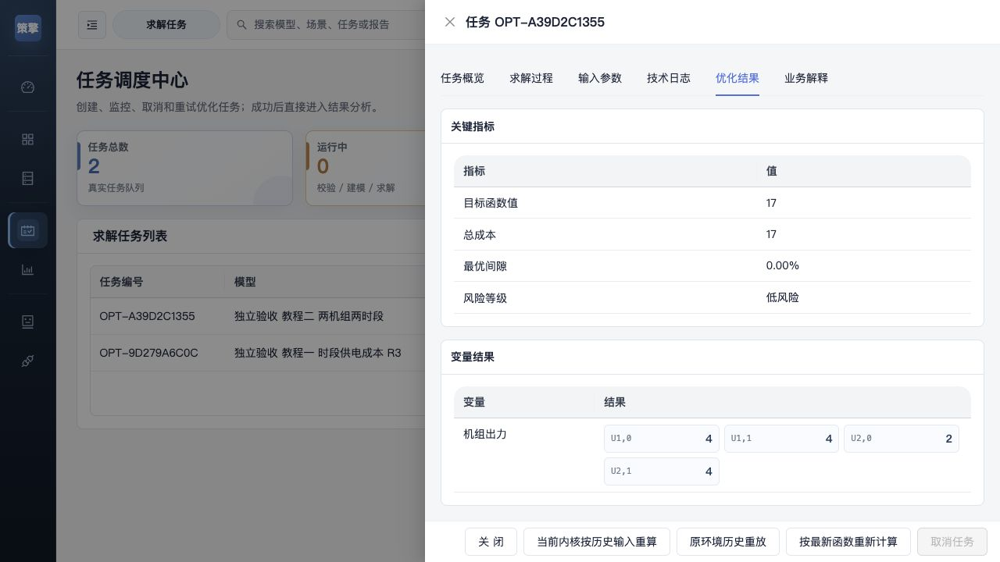

若无解，先确认每时段容量总和是否至少达到需求。本例时段 0 为 8≥6，时段 1 为 10≥8。若故意把需求第二个数改为 11，会超出 10 的总容量，属于数据与模型共同形成的不可行条件；应更改业务方案或容量，不能靠增加求解时限修复。

### 8.4 公式练习：状态递推与初末边界

这是在 8.2 基础上的**扩展练习，未列为本轮 UI 通过项**。它用于展示完整边界设计和复算；按下列步骤另建副本，实际编译与整体求解通过前不要发布。这里是无损能量累计示例，不代表包含效率、容量和充放电互斥的完整储能模型。

1. 复制 8.2 模型为独立模型，保留通用线性 Builder。第二步打开“使用状态时点集合”，选 `time_volume`；2 个调度时段应对应 `time=[0,1]` 和 `time_volume=[0,1,2]`。
2. 新增连续变量 `energy`，名称“累计供电能量”，维度 `time_volume`，下界 0、上界 100、单位 MWh。保留 `p[time]`、需求及费用公式。
3. 第三步新增并逐条编译以下约束。初值、末值都是独立约束，不能只写递推：

| 名称 | DSL | 边界策略 | 数学上应形成的约束 |
| --- | --- | --- | --- |
| 初始能量 | `energy[0] == 0` | 严格校验 | 1 条，固定初值 |
| 能量递推 | `energy[t+1] == energy[t] + p[t] * delta_t` | 严格校验 | 2 条：0→1、1→2 |
| 期末能量 | `energy[2] == 15` | 严格校验 | 1 条，固定末值 |

递推自由索引应对应调度集合 `time`。本例状态有多一个末时点，最后一次引用 `energy[2]` 合法；如果编译器把 `t` 推到错误集合、或提示歧义而无法确认，不要应用，保留诊断交建模工程师处理。本轮没有把这一复杂推断路径当作已验证功能。

4. 测试输入沿用 8.2。独立期望为 `p=[10,20]`、`energy=[0,5,15]`、费用 40。分别计算 `5-0-10×0.5=0`、`15-5-20×0.5=0`，同时核对初值 0 与末值 15。

若递推变量与时段都只用 `[0,1]`，`t=1` 的 `t+1` 越界。只选择“跳过末时点”会丢掉第二段能量平衡；本例应修正状态集合长度，而不是跳过合法末段。对于同集合上的爬坡式 `p[t]-p[t-1] <= ramp`，才通常需要“跳过首时点”，并另外声明首时段相对已知初始出力的边界。

SOC 的同类手工核算：容量 100 MWh、初始 SOC 0.4、充电 10 MW、效率 0.9、0.5 小时、无放电，则下一时点能量 `40+10×0.9×0.5=44.5 MWh`，SOC 为 0.445。要核对的是能量变化 4.5 MWh，不能把功率 10 直接加到 SOC。该数值是核算练习，不是本轮平台求解输出。

### 8.5 字段参考：含义、填写规则与修改影响

| 对象 / 字段 | 填写规则与是否必填 | 不填或填错的影响 | 修改后的动作 |
| --- | --- | --- | --- |
| 集合编码、名称 | 编码用于引用；名称用于显示，均需填写 | 引用未知编码会失败 | 同步参数 / 变量维度和公式，重编译、重测 |
| 集合成员 | 非空 JSON 数组；成员为不重复的非空字符串或有限数值 | 无法保存或空集合无法展开 | 同步每个轴的数据键或数组顺序 |
| 默认规模 | 规模描述，不代替成员 | 不能据此推断真实实体 | 核对实际成员数量 |
| 参数编码、名称 | 声明后才可在公式、绑定中引用 | 运行数据有同名键也不会自动成为已定义符号 | 重新编译并校验契约 |
| 参数维度 | 标量留空；数组按集合编码写 `unit,time` | 轴顺序错会改变取值含义 | 重排数据、重编译、整体测试 |
| 默认值 | 可选；合法 JSON 数值 / 数组 / 对象，结构须符合维度 | 没有当前值也没有默认值的必填参数阻断 | 核对本次实际采用值，重新测试 |
| 示例值 | 可选；作为输入提示或显式填充样例 | 不表示已接入真实数据 | 使用前确认来源与单位 |
| 运行必填 | 控制缺值是否阻断，不会生成值 | 关闭必填不使公式里的缺值自动有效 | 整体测试验证实际取值 |
| 单位 | 写清业务单位；不自动完成所有物理换算 | MW、MWh 或元/MWh 混用可能数值合理但含义错误 | 明确时长 / 效率换算，重新核算 |
| 变量类型、上下界 | 连续 / 整数 / 二元按业务选择；索引用集合编码 | 不适当边界可导致无界或错误可行域 | 重新编译、测试并核对问题类型 |
| 来源 | 运行时、静态、台账、系统按实际供数方式选择 | 来源标签不建立外部数据连接 | 核对最终运行数据及来源 |

### 8.6 时间维度的配置方式

| 配置方式 | 任务中心表现 | 操作要求 |
| --- | --- | --- |
| 非时序模型 | 无调度周期编辑 | 不强行加入 horizon |
| 固定时段 | 只读固定点数 | 数据按固定契约准备 |
| 运行时自由调整 | 输入允许范围的点数 | 配置默认值、上下限和步长 |
| 候选时段切换 | 选择预设点数 | 每个候选值核对粒度和 delta_t |
| 由输入数据推导 | 从主序列推导周期 | 试验能力，需检查来源与维度 |

horizon 是点数，时间粒度是每点分钟数，delta_t 是本例公式使用的每点小时数。24×60 分钟与 96×15 分钟均可表示一天，改变点数不会自动把真实预测重采样。时间标签用于展示，不应拿标签代替数学成员。

### 8.7 公式参与、编译与发布

| 状态 | 含义与检查 |
| --- | --- |
| `solve_active` | 意图参与求解，仍需最终变量、约束与目标核对 |
| `preview_only` | 仅说明，不计入求解 |
| `disabled` | 当前停用 |

单公式“后端编译与展开”→应用→整体编译→保存→整体测试→数值复核→发布是连续步骤，任一步不能代替下一步。变量乘变量、直接 abs/min/max、未线性化的非线性式不能只改求解器名称就视为支持。NLP 需可用 Ipopt 并确认局部最优风险，MINLP_RESERVED 阻断正式发布；二维精确 PWL 的规模超过默认 4000 阈值时也会阻断。

**发布后维护：**草稿编辑同一 ID；从未正式发布的试运行可退回草稿；发布过的资产创建新版本。每次内容或依赖改变后重测，只有当前 ID 与内容 Hash 一致的测试证据才可发布。测试通过但数值复核不通过，必须保留草稿 / 试运行并提交问题，不发布。

---

## 9. 创建求解任务

入口：`/tasks → 创建任务`，或首页“发起优化任务”。向导分为“选择模型 → 填写运行数据 → 检查并提交”。

### 9.1 选择模型与契约

选择已发布模型后，核对场景、问题类型、时间维度和默认求解器。若全部契约来源加载失败，点击“重新加载契约”；部分来源失败但界面明确使用兼容契约时，可按检查结果继续。

切换模型可能清空已填参数，页面会要求确认。需要保留的数据应先留存，再切换模型。

### 9.2 运行数据工作区

顶部显示模型、点数、粒度、必填完成度和问题数量。按业务分组编辑，可筛选全部、缺失或已修改字段，并查看默认、手工、历史、文件和 JSON 等来源。

| 参数形式 | 界面 | 填写要求 |
| --- | --- | --- |
| 标量 | 数字、文本、枚举或开关 | 符合类型、范围和单位 |
| 一维序列 | 带成员或时间标签的表格和预览曲线 | 点数与对应集合一致 |
| 一维映射 | 键值表格 | 键对应机组、电站等编码 |
| 二维参数 | 行列矩阵 | 按表头和维度方向准备 |
| 高维或复杂对象 | 结构化 JSON | 保持嵌套深度和键结构 |

例如 `[unit,time]` 通常以机组为行、时段为列，`[time,unit]` 的方向相反。必须核对字段维度和表头。

### 9.3 从 Excel 批量粘贴

1. 在 Excel 中选择纯数据区域，排除标题、单位行和备注。
2. 点击当前参数的“批量粘贴”。
3. 粘贴单列、多行或矩形区域，支持 Tab 或逗号分隔。
4. 核对识别行列数、预期规模和实际规模。
5. 处理非数字或行列错误后，点击“确认导入”。

数值不应包含千位分隔逗号。空单元格导入后仍需检查，不能默认等同于业务上的零。

### 9.4 CSV 导入与下载模板

任务参数 CSV 针对**当前一个参数**的序列或矩阵。先点击“下载模板”，按模板填入数据，再“CSV 导入”。导入后检查表格、曲线和参数问题。

任务参数 CSV 使用纯值网格，没有函数资产中心的列名映射功能。不要加 `time,value`、`x,y` 或中文表头。

四点负荷单列示例：

```csv
160
190
175
150
```

矩阵各行保持相同列数；复杂对象和三维以上结构优先使用 JSON，避免压扁维度。

### 9.5 矩阵聚焦与恢复操作

矩阵提供“聚焦编辑”、批量粘贴、CSV、填充默认值、恢复原值等操作。当前超过 1000 个单元格时建议聚焦编辑，超过 5000 个单元格时优先提示导入方式。

“清空”清除字段数据，“填充默认值”应用默认结构或值，“恢复原值”恢复当前编辑初始值。执行后仍应核对数据与调度周期。

### 9.6 从历史任务载入

1. 点击“从历史任务载入”，选择兼容的成功任务。
2. 查看时间、求解器和历史 `horizon`。
3. 选择“仅填充当前空值”或“覆盖当前参数”。
4. 点击“确认载入”，查看应用和忽略的参数数量。
5. 按本次业务日期重新复核数据。

已知历史周期与当前不一致时，页面会阻止直接载入。未知参数不会自动成为当前模型的新输入。

### 9.7 高级 JSON 输入

点击“展开高级 JSON 输入”，填写参数对象，再点击“导入并合并”。根节点必须为对象，不能是裸数组。

```json
{
  "load_forecast": [160, 190, 175, 150]
}
```

按顶层参数键合并，同名参数被新值替换。复杂参数应提供该参数完整的预期结构，不要假设内部键会递归补齐。系统时间字段按时间契约忽略。

JSON 解析成功只代表格式合法，仍需要通过字段类型、必填、维度、引用和时间检查。

### 9.8 调整调度周期

- 固定周期只读，不在任务中强行改成其他点数。
- 可变周期在允许范围或候选值中选择。
- 数据推导模式先提供主时间序列，再检查推导结果。
- 缩短周期时，确认截断尾部时段；状态时点保留 `horizon + 1` 个值。
- 增大周期后，补齐新增负荷、价格、容量、计划和其他相关数据。

LP/MILP/PWL/McCormick 通常使用 HiGHS，支持的连续 NLP 使用 Ipopt。

### 9.9 检查并提交

检查参数问题并按条目定位字段。确认模型、周期、求解器、有效参数数量和最终 JSON 后，点击“提交求解并打开详情”。

提交会创建真实异步任务，等待返回并记录任务编号，避免因等待较长重复创建同一请求。

---

## 10. 任务调度中心

入口：`/tasks`。列表显示任务、模型、状态、进度、求解器、创建时间和目标值。运行状态会刷新，进度百分比表示流程推进，不是剩余时间预测。

### 10.1 任务详情

| 页签 | 查看内容 |
| --- | --- |
| 任务概览 | 状态、模型 ID、求解器、目标值、终止条件、约束违反与错误 |
| 求解过程 | 排队、校验、建模、求解、结果整理的阶段和耗时 |
| 输入参数 | 本次实际使用的模型版本、周期和业务数据 |
| 技术日志 | 平台和求解器执行日志 |
| 优化结果 | 关键指标与变量 |
| 业务解释 | 结论、失败原因、风险、证据和处理建议 |

运行中优先查看求解过程，成功后查看结果，失败时结合解释与日志排查。

**成功任务的具体核对。**任务中心按编号找到本次任务 →“查看详情”→“任务概览”。HiGHS 最优解的“终止状态”应为 `optimal`；“约束违反摘要”显示已检查条数、违反条数、最大违反量、变量边界检查及容差。例如一维教程应检查2条需求约束，违反0条、最大违反量0。它来自本次实际求解的数值检查；尚无检查证据时会说明“尚无可核验的约束检查结果”。

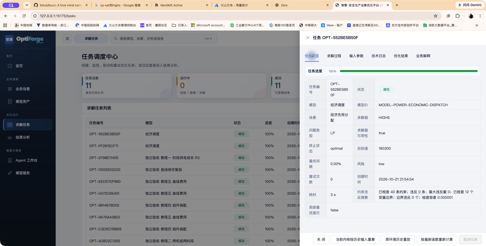

### 10.2 最优解搜索与收敛轨迹

“求解过程 → 最优解搜索”可显示最好解、界、Gap、搜索事件与真实轨迹，具体取决于求解器返回内容。

- 当前最好解：已经找到的可行方案目标值。
- 界：用于衡量最优性差距的界值。
- Gap：可行解与界的相对差距，口径以求解器字段为准。
- 无轨迹：可能完成太快、没有中间采样，或当前路径未提供记录。

LP 迭代与 MILP 搜索的含义不同，不能仅凭图表样式或进度条判断是否已经最优。

### 10.3 取消与重试

运行中任务可在“更多”或详情底部取消，终态任务不能再次取消。操作后确认状态更新。

**重试**复用原任务编号和冻结请求 / 依赖，先归档上一 attempt，再清除当前结果与失败进度并增加重试次数。实际使用当前执行内核，每次环境单独记录；它不保证恢复原 Python / 求解器环境。**新建任务**产生新编号，适合修改业务数据或模型后计算。

任务详情的“当前内核按历史输入重算”另外建立新任务并保留原结果；“按最新函数重新计算”明确选择新修订，不能与失败重试混为一谈。缺历史模型定义 / 函数 / 组件执行快照时会拒绝历史重算，保留旧结果。“原环境历史重放”在本版未建设完整环境恢复能力，不能据按钮存在承诺可用。

当前后端接受 `FAILED`、`TIMEOUT`、`CANCELLED`、`INTERRUPTED` 的原任务重试。`INFEASIBLE` 应修正后新建；部分页面可能显示无解任务的重试入口，但后端会拒绝该状态的原任务重试。

### 10.4 删除任务记录

终态记录可在“更多 → 删除记录”中删除，会同时移除该任务归档结果，无法通过页面撤销。运行中任务先取消并确认结束，需要留档的输入与结果先保存。

### 10.5 无解与失败排查

1. 查看概览、业务解释和技术日志，区分参数、建模、环境与数学无解。
2. 检查负荷与可用容量、上下界方向及单位。
3. 检查初始 SOC、库容、出力是否在边界内。
4. 检查期末目标、爬坡、启停、检修、生态下泄或 SLA 是否过紧。
5. 检查时间粒度、序列长度、对象编码与函数引用。
6. 修正后创建新任务并保留前后输入。

格式正确的数据仍可能共同形成无解条件。原样重复无解输入通常不能解决问题。

---

## 11. 结果报告库

入口：`/results`。列表展示已归档结果、关联模型、目标函数值和 Gap。点击“查看报告”打开详情，页签随模型返回的能力与展示契约变化。

### 11.1 查看报告

| 内容 | 用途 | 重点 |
| --- | --- | --- |
| 结果概览 | 状态、目标值、耗时和关键指标 | 指标的业务含义与单位 |
| 变量曲线 | 出力、SOC 和其他时间序列 | 时间对齐、边界和突变 |
| 业务输出 | 模型提供的业务计划与汇总 | 分项口径与设备计划 |
| 约束检查 | 约束校核和违反摘要 | 越界、残差和软约束 |
| 水库过程、出力与负荷 | 水电专题 | 水量平衡、库容、流量和出力 |
| PWL 诊断 | 函数、插值、三角片信息 | 策略和近似条件 |
| 求解或收敛诊断 | NLP 等元数据 | 终止条件、可行性和局部最优风险 |
| 业务建议 | 解释、风险和后续建议 | 是否有输入、指标和约束证据 |
| 原始结果 | 完整结构化 JSON | 实际字段和值 |

不是所有模型都拥有全部专题页签；先看当前报告，再按需要查看原始结果。

**查看逐条约束。**结果报告库按任务编号找到本次结果 →“查看报告”→“约束检查”。每行列出约束编码、实际值、下界、上界、余量、违反量和检查结果；没有一侧边界时该侧为“-”。一维教程的两条需求约束实际值应为10、20，下界10、20，余量和违反量均0，状态“触边”。有正违反量且超过检查容差时为“违反”。只有求解中已生成并有数值证据的约束才会列出；缺数值的条目保留未完成检查提示。

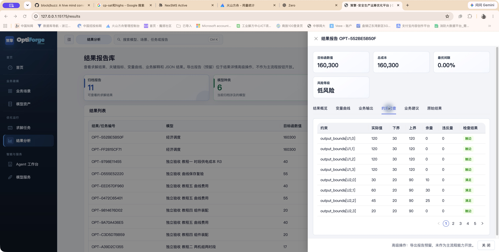

### 11.2 理解目标值与 Gap

目标值可能是成本、负收益、偏差罚项或多项加权和，不能直接当作利润。跨结果比较前，核对同一模型版本、目标方向、时域、单位、权重和基准。

Gap 主要用于相应整数求解路径的最优性判断，不能替代 NLP 收敛容差。任务显示 `SUCCESS` 后，仍应阅读实际终止条件和约束违反摘要。

### 11.3 解释与证据

部分模型提供事实、推断、建议、风险以及 `EvidencePackage`，可核对解释引用的输入、指标和约束。单次计算未提供对照基准时，不应自行推导“比历史提升多少”的结论。

### 11.4 保存与导出

前端报告导出仍为预留入口，没有完整的主流程下载功能。可在原始结果查看并复制 JSON，或使用 `GET /api/tasks/{task_id}/result` 保存数据。

后端另有 `POST /api/reports/export`，可由集成程序根据实际输入和结果生成 HTML。`word` 选项生成的是 HTML 内容的 `.doc`，不是原生 `.docx`。使用方法见第 21 章。

---

## 12. 组件资产与函数曲线

这些功能主要面向建模工程师和平台管理员，需切换到专家视图。

<a id="121-教程四创建组件并装配到模型"></a>

### 12.1 教程四：创建组件并装配到模型

**任务目标。**将“逐时出力上限＋线性供电成本”封装为组件，模型中编码为 `capacity_limit` 的参数显式映射到组件的 `max_output`。修复后应完成组件定义、执行校验、发布、不同编码映射、求解、模型发布及重开。下面给出完整输入和预期结果；独立代理 UI 结果另见验收记录。

#### A. 创建接口和公式

1. 切换全局“专家视图”，组件资产 →“新建组件”，进入“组件编辑器”。
2. “基础信息”填组件名称 / 展示名称“手册容量与线性费用”、编码 `manual_cap_cost`、版本 `1.0.0`。保留默认分类“基础组件”、领域“通用”。如同名编码存在，使用自己的唯一编码，后续选择同一资产。
3. “集合配置”→“新增集合”：编码 `time`、名称“时段”，其他可选字段留空。这里声明需要的集合，实际 `[0,1]` 在模型中提供，不能把组件接口的默认值当作集合成员编辑器。
4. “参数接口”→“新增参数接口”，逐行填写：

| 编码 | 名称 | 维度标签 | 单位 | 必填 | 默认值 / 示例值 |
| --- | --- | --- | --- | --- | --- |
| `max_output` | 最大出力 | 输入 `time` 后按 Enter 成为标签 | MW | 开 | 默认值 `[15,25]`，示例值可留空 |
| `unit_cost` | 单位成本 | 留空，标量 | 元/MWh | 开 | 默认值 `2` |
| `period_hours` | 时段长度 | 留空，标量 | h | 开 | 默认值 `0.5` |

组件编辑器的“维度”是标签控件，和模型语义中的逗号文本框不同。每个集合单独输入并按 Enter。

5. “变量配置”→“新增变量”：编码 `p`、名称“供给功率”、维度标签 `time`、单位 MW。该编辑区没有模型变量弹窗里的完整类型 / 上下界配置，模型侧仍需核对变量边界。
6. “约束公式”新增“出力上限”，DSL：`p[t] <= max_output[t]`，参与求解、严格边界，后端编译并应用。目标项新增“供电费用”，最小化、权重 1，DSL：

~~~text
sum(unit_cost * p[t] * period_hours for t in time)
~~~

7. “依赖关系”留空，此组件没有上游组件。保存草稿，进入详情“校验结果”，点“校验”，应看到“执行校验通过”；再“发布组件”，回基础信息确认“已发布 published”“可用于新模型”。

**默认值输入与纠正。**默认值 / 示例值按 JSON 填写：数字填 `2`，数组填 `[15,25]`，对象填 `{"U1":15}`；不加引号包住数字或整个数组。空白表示未设置，`0` 是有效数值。保存后重新编辑，应仍显示完整 JSON 数组。旧草稿曾填成文本时，在对应栏重新填正确 JSON，保存并重新校验，无需删除接口行；已发布组件通过“复制为新草稿”建立新修订。校验仍提示 VarData 与 str 无法比较时，检查是否写成了 `"[15,25]"` 或 `"2"`，并核对模型本次运行值。

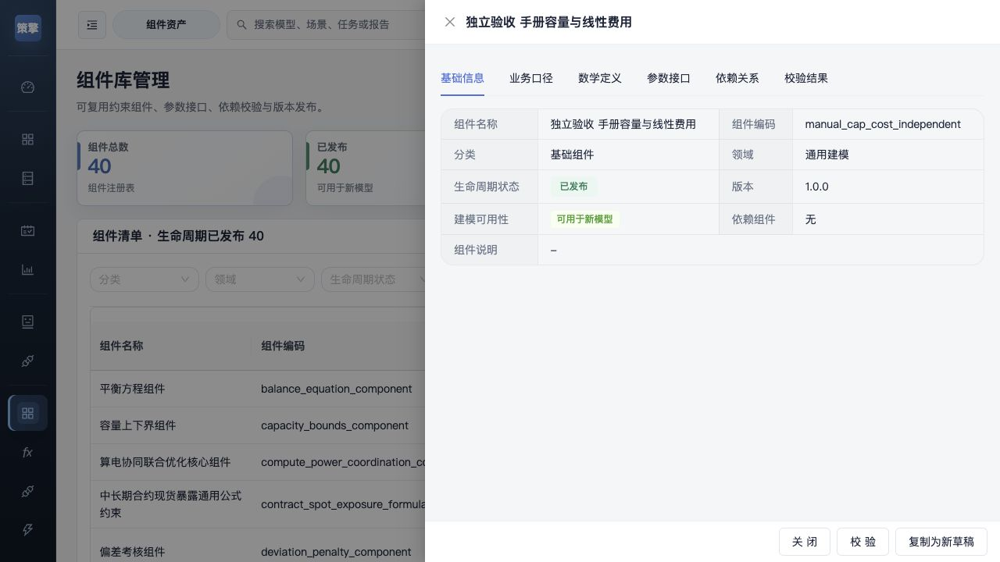

#### B. 装入模型并绑定不同编码的参数

使用 8.2 已发布模型的“复制为独立模型”，改名“手册教程四 组件装配”。若复制后直接进入第二步，点“上一步”回基础信息，在 Builder 选择组件化，然后保存，进入第二步。此例保留原模型作为对照。

1. 第二步保持 `time=[0,1]`、30 分钟；点“从组件库选择”，在“搜索组件名称、编码、领域或分类”输入 `manual_cap_cost`，勾选对应行，再“应用选择”。
2. 组件会合并所需集合、参数和变量。已存在同名变量 `p` 时核对维度，不要再手动添加同一变量。页面可见 `max_output`、`unit_cost`、`period_hours`；这只完成接口声明，不表示运行值已提供。
3. 为演示不同编码绑定，将模型“最大出力”的编码改为 `capacity_limit`，维度 `time`，默认值 `[15,25]`，单位 MW。将模型变量 `p` 的下界改为 `10`、上界保留 `100`。此例表达每时段至少保持 10 MW 运行，不是沿用 demand 的负荷模型。
4. 在“组件与依赖”的该组件卡片点“绑定”，抽屉标题应为“手册容量与线性费用 / max_output”。“映射到模型参数”选择 **最大出力 (capacity_limit)**；确认“运行参数键”不再同时指向旧 `max_output`；单位 MW；索引方式“按集合索引”，选择“时间点 (time)”。点“保存并校验”。
5. 第三步组件审计表的“参数绑定记录”应显示下列映射。其他参数保持同名自动绑定即可：

| 组件内部参数 | 模型实际参数 | 本次数据 |
| --- | --- | --- |
| max_output | capacity_limit | `[15,25]`，按 time 顺序 |
| unit_cost | unit_cost | `2`，标量 |
| period_hours | period_hours | `0.5`，标量 |

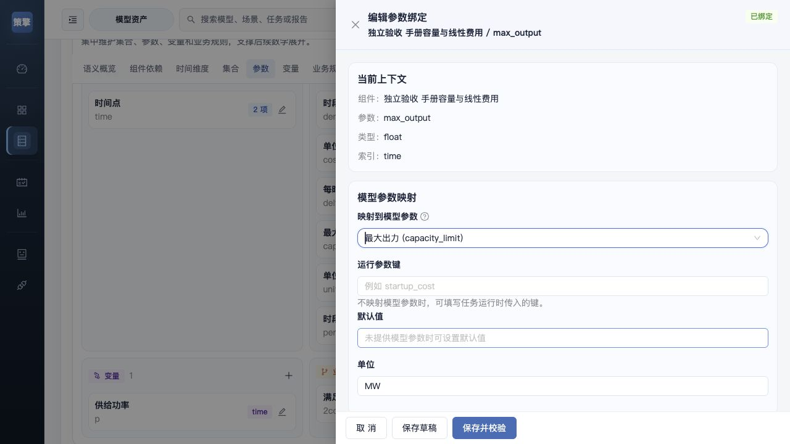

抽屉检查映射完整性和所选集合是否存在，并提示类型、维度及单位需模型整体测试确认。本例需要 `max_output[time]` 对 `capacity_limit[time]`，不能映射到标量或 `unit,time` 二维数据；修改单位文字也不会自动把 kW 换成 MW。单位或轴不一致时，先回第二步修正模型参数，重新绑定、保存和整体测试。

6. 在第三步“公式维护”表找到复制来的“满足时段需求”和“半小时供电费用”，分别点行内“停用”，确认参与状态变成 `disabled`。只保留组件公式与变量 10 MW 下界。组件审计视图应各显示一条出力上限和供电费用，不把兼容字段中的同一公式重复列出。
7. 第四步按字段填写 `capacity_limit=[15,25]`、`unit_cost=2`、`period_hours=0.5`，按 Enter 或移出输入框提交；最终结构预览必须出现三个键及正确数字类型。复制来的 demand / cost 即使仍存在，也不代表参与本组件求解。若只为新业务建模，应在清理引用后删除不用的定义，重新测试。

验收应得到 `p=[10,10]`，上限裕量 `[5,15]`，目标 `(2×10+2×10)×0.5=20`。上下界和目标都要复核，不能只看求解成功。

#### C. 整体测试、发布与重开

1. 保存草稿，等待“已保存”。第五步先完成本地检查；“本地检查通过，仍需后端测试确认”只表示可以提交测试。
2. 点内容区“测试运行”，等待真实测试完成。结果须 `optimal`，出力两个 10，目标 20。失败时面板会显示后端字段、错误和修复建议（如果后端提供），按错误返回对应步骤修改，保存后重新测试。
3. 结果正确后点“发布模型”，回模型资产中心重新打开，确认已发布、参数 `capacity_limit` 及其绑定、变量下界 10 均保留。不要把组件内部参数 `max_output` 再当作一个额外必填模型参数。

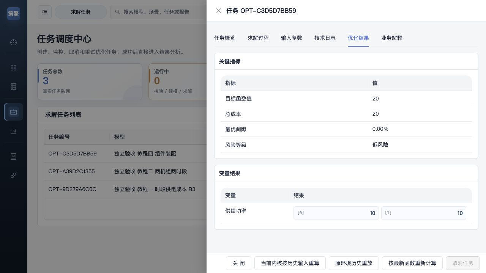

已发布组件不可直接修改；列表“复制编辑” / 详情“复制为新草稿”建立后续资产。模型详情自己的“专家视图”中有“组件更新与修订”：选择需要变化的目标修订 →“更新组件并测试”→核对候选结果→“应用组件更新”。未选择的组件、函数和参数绑定保留原样；普通停用保留合法历史绑定，安全撤销可能阻止执行。组件修订更新属于额外维护操作，本轮验收范围和实际结果见修复与验收记录。

<a id="122-教程五创建费用曲线并绑定模型"></a>

### 12.2 教程五：创建费用曲线并绑定模型

**目标。**创建 `fee=f(p)` 的费用率曲线，使需求约束、曲线映射及半小时费用目标共同进入求解。r1 应为 40 元，明确选择 r2 更新后应为 55 元；旧固定模型继续使用 r1。

#### A. 创建 r1 曲线

专家视图 →“函数与曲线”→“导入 CSV”，按下表填写：

| 区域 | 填写值 |
| --- | --- |
| 资产名称 | 手册费用曲线 |
| 函数类型 | 一维曲线 y=f(x) |
| 求解策略 | MILP 分段（segment_binary） |
| x 单位 / 输出 y 单位 | MW / 元/h |
| CSV 内容 | 下方三行点数据，含表头 |
| 字段映射 | x 列 → x，y 列 → 输出 y |
| 高级配置 → 函数 ID | manual_cost_curve（存在时换唯一 ID） |

~~~csv
x,y
0,0
10,20
20,60
~~~

可用 [r1 CSV 样例](manual-assets/2026-10-21/cost-curve-r1.csv) 上传或复制内容。确认预览为 3 个点、x 递增且不重复，再“导入为草稿”。列表应显示 `manual_cost_curve · 修订 1`、校验“正常”、MILP 分段。草稿生命周期与数值校验状态是不同字段，不要仅按“草稿”判断点数据无效；模型能否发布仍以完整发布校验为准。

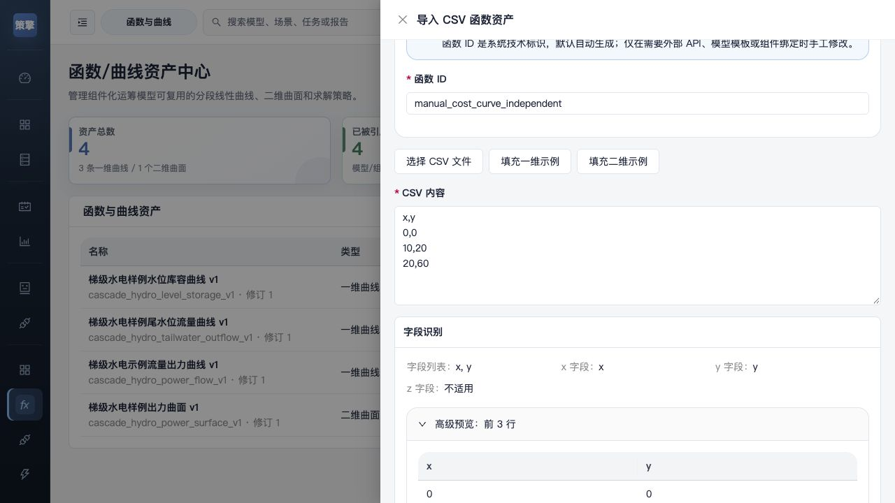

在 x=15 时独立插值：`20+(60-20)×(15-10)/(20-10)=40 元/h`。资产图上能算出 40 只证明曲线计算，不证明优化模型调用了它。

#### B. 建立输入、输出变量并绑定

从 8.2 模型“复制为独立模型”，名称“手册教程五 曲线费用”，回第一步切到“组件化 Builder”，保留 `time=[0,1]`，新增连续变量 `fee[time]`、下界 0、上界 100、单位元/h。保留原模型，不覆盖其版本。

1. 第二步“组件与依赖”→“从组件库选择”，搜索“函数映射”，选择编码 **`function_mapping_component`** 的“函数映射组件”，应用。它不是二维组件 `function_mapping_2d_component`。
2. 第三步进入该组件的“绑定函数资产”。先确认选中正确资产 ID，不能默认采用列表第一条。逐项填：

| 字段 | 值 | 影响 |
| --- | --- | --- |
| 函数资产 | 手册费用曲线 (manual_cost_curve, valid) | 使用指定资产的固定修订 |
| 输入 x 表达式 | `p[t]` | 求解器决定的出力作为曲线输入 |
| 输出 y 表达式 | `fee[t]` | 曲线费用率输出到变量 |
| 索引集合 | `time` | 每个时段建立映射 |
| 索引别名 | `t` | 连接上面表达式的索引 |
| 求解策略 | `segment_binary` | 采用相邻分段 MILP |
| 约束名称 | 可保留自动生成值 | 供诊断追踪 |

3. 点“保存绑定”，确认函数映射出现在数学展开。回第二步变量表编辑 `p`，下界 `0`、上界 `20` MW，保存。边界必须符合曲线定义域；函数不允许把超域出力当作已按业务外推。
4. 在第三步“公式维护”表保留需求约束 `p[t]>=demand[t]` 为 `solve_active`。找到旧“半小时供电费用”点“编辑”，将 DSL 改为 `sum(fee[t] * delta_t for t in time)`，最小化、权重 `1`，后端编译并“应用公式”。也可停用旧费用公式后另建这个目标，但不能同时启用两套费用。点击“批量权威编译”，确认启用公式编译通过。模型自有公式在组件化模式仍参与执行。

![图 12-5：① 正确函数资产；② p[t] / fee[t]；③ time 与 t；④ 分段策略；⑤ 保存绑定。](manual-assets/2026-10-21-repair/independent/19-curve-r1-binding.jpg)

第四步本次输入沿用：

~~~json
{"demand":[10,20],"cost":[2,3],"delta_t":0.5}
~~~

其中 cost 是复制模型遗留值，不应进入曲线费用目标。fee 是决策变量，不作为业务参数输入。

#### C. 用数值判断曲线和业务约束是否真的参与

如果模型完整表达上述意图，独立验收应为：

| 时段 | demand / 正确 p，MW | r1 曲线 fee，元/h | 费用，元 |
| --- | --- | --- | --- |
| 0 | 10 / 10 | 20 | 10 |
| 1 | 20 / 20 | 60 | 30 |
| 合计 | — | — | **40** |

第五步保存、测试，核对 `optimal`、`p=[10,20]`、`fee=[20,60]`、目标 40；确认后发布，从列表重开并核对绑定 r1。若任务显示 SUCCESS 而目标为 0 或第二时段 p 小于 20，仍应停止发布：先检查需求 / 目标是否启用、DSL 是否已应用、当前草稿是否已保存及测试是否为本次内容，再保留 ID 和输入交开发。R2 曾出现此故障，原失败证据保留在历史验证记录；不能把旧任务结果当作本轮新测试结果。

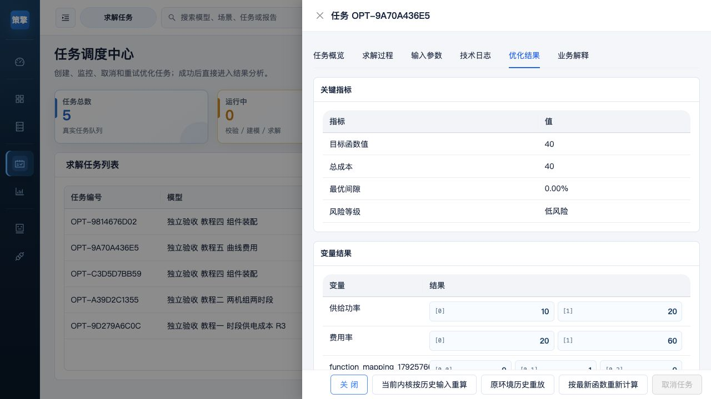

#### D. 修改曲线并选择更新范围

前提是 r1 模型已经数值验收并发布。下面维护同一个函数资产的新修订；基础模型测试未通过时，先处理上一节，不直接应用更新。

1. 函数与曲线列表 →“手册费用曲线”→“编辑”。保留 x 为 `0,10,20`，把 y 改为 `0,30,80`，保存。列表应显示“修订 2”。点数据 / 单位 / 类型等变化由修订记录管理，不直接改写旧修订。
2. 打开引用模型详情 → 点详情标题旁的“专家视图”（与全局菜单视图分别控制）→ **“函数更新与修订”**。
3. 表中核对函数、使用修订 `r1`、可用最新 `r2`、已用 Hash。资产有新修订不等于所有模型自动采用它。

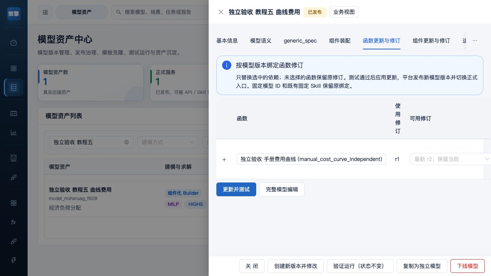

4. 对**已经数值验收合格的基础模型**，在需要变化的函数行选择目标修订。未选择的函数保持原修订；展开行查看断点、定义域和契约差异。标注“需完整模型编辑”的选项不能快捷更新，使用“完整模型编辑”，同步修改变量、单位或维度。
5. 点击“更新并测试”。当前实现建立候选模型新 ID 和测试任务，异步跟踪，不立即替换正式入口。连接未确认时用“恢复更新并测试”，不要另开一轮重复提交。
6. 任务成功后看候选对比、“物理量、变量及目标分项”，按相同业务输入复算。r2 的验收值为 p 仍 `[10,20]`、fee `[30,80]`、总费用 `15+40=55`；同时核对没有混入旧线性成本。
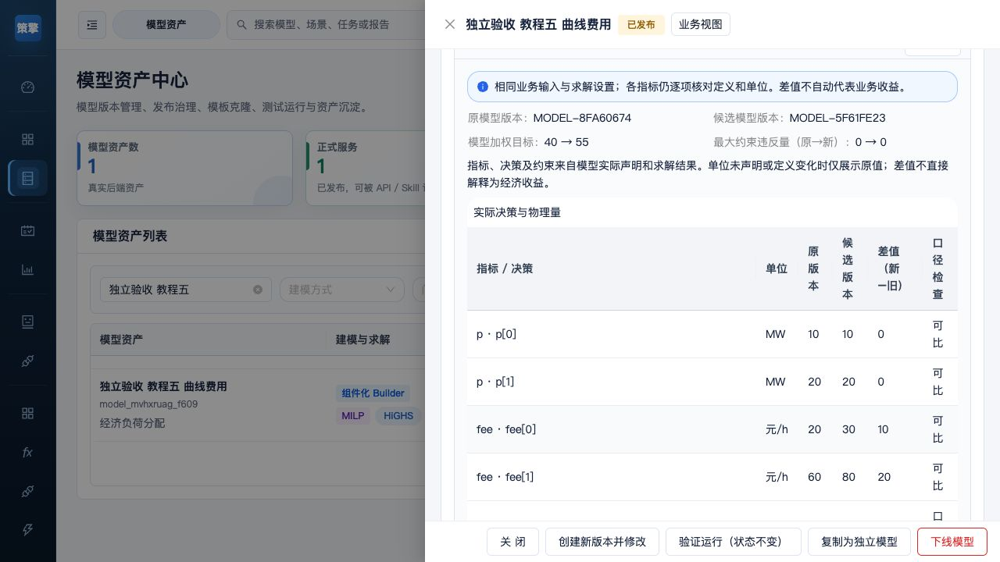

7. 只有任务 SUCCESS、候选 ID 与当前内容 Hash 对应且业务复核通过，才点“应用更新”。实现会发布新模型版本并切换模型族正式编码；旧固定 ID 和既有固定 Skill 保留原绑定。被新版本替代的旧模型显示“历史下线”，历史记录保留，调用权限仍按该版本状态检查，不会自动把固定绑定改成新版本。未通过则“保留原版，结束本次更新”，候选与任务仍可用于定位。

历史任务不会因最新曲线变化而改写。任务详情“当前内核按历史输入重算”使用冻结请求与依赖、当前内核；“按最新函数重新计算”是明确选择新修订并建立候选新任务。原环境历史重放还需要完整历史环境支持，当前不能把按钮存在当作严格环境重放已实现。缺历史快照会明确阻断，不用最新资产偷偷代替。

### 12.3 函数策略、字段与边界参考

| 字段 / 策略 | 填写与影响 |
| --- | --- |
| 函数 ID | 稳定引用编码；新建时唯一，模型绑定检查 ID 与修订 |
| x / y / z 名称与单位 | 逐个定义物理含义；修改单位需要检查模型绑定及契约 |
| 1D 点 | 至少 2 个数值点，x 严格递增且唯一；重复点需先修正 |
| 2D 点 | 至少 3 个不重复且不共线的点；规则网格和三角索引需一致 |
| 定义域与外推 | 本版生产 PWL 禁止任意外推；核对变量有效上下界与点域 |
| `segment_binary` | 一维相邻分段 MILP；本教程选择此项 |
| `sos2` / `binary_segment_milp` | 兼容策略，当前 HiGHS 采用等价相邻分段处理 |
| `convex_combination_lp` | 历史一维兼容名，当前有效策略归一为相邻分段，不能据名称承诺仍是纯 LP |
| `display_only` | 仅展示，不可当作求解约束 |
| `convex_hull_lp_approx` | 二维凸包 LP 近似，非一般曲面的精确三角片关系 |
| `triangulated_milp_exact` | 二维三角剖分 MILP，精确表示给定 PWL 面，增加整数规模 |

“精确”相对于输入 PWL，不能替代原物理曲线误差分析。仅画图、资产 valid、绑定成功都不足以证明数值模型正确。二维预览 triangle / lambda 仅在后端返回时展示，不应假定所有点都可合法插值；McCormick 另需有限有效上下界。

### 12.4 组件和函数的重新打开与历史留存

先保存草稿，回资产列表按编码重开核对版本 / 修订 / Hash。改组件用复制草稿，改函数产生后续修订；改模型依赖后都需要重新测试。模型族的活动正式版本、指定 ID、Skill 固定模型、函数修订、任务冻结快照分别记录，不能只记一个“最新”标签。历史依赖缺失或校验不一致时保留原结果并上报，不以重建空资产冒充原定义。

---

## 13. 模型服务与在线调试

入口：`/services`，兼容入口为 `/model-services`。

模型服务治理页面只展示已发布模型服务。可查看：

- 服务名称和模型编码。
- 服务状态。
- 推荐求解器。
- 输入参数契约。
- 输出参数契约。
- 调用记录。
- 示例请求和示例响应。

### 13.1 在线调试（异步任务）

1. 左侧“模型服务”搜索并选择已发布的“手册教程一 时段供电成本”。在“服务概览”核对**固定模型 ID**、正式服务编码和输入格式。
2. “在线调试”→“运行参数 JSON”粘贴：

~~~json
{"demand":[10,20],"cost":[2,3],"delta_t":0.5}
~~~

3. 点击“发起测试调用”。会创建真实**异步任务**，立即出现任务编号和 VALIDATING 等状态；页面自动跟踪到终态。它不是同步阻塞等待，也不是静态校验。
4. 记下任务编号，可“跳转任务中心”。在同一浏览器会话返回本页时可继续跟踪；“恢复任务”用于恢复已记住的任务，终态后“新建测试调用”才启动另一轮。不要因短时无结果反复创建任务。
5. 成功后核对 `resolved_model_id` 等于所选 ID，status SUCCESS、HiGHS、objective_value 40，并到任务结果检查 `p=[10,20]`。失败查看 error 与日志，保留任务编号后修正数据。

本轮任务 `OPT-8ADC67A6B8` 从 VALIDATING 到 SUCCESS，目标 40。在线调试**固定当前模型 ID**；开发者信息里的外部 API 示例用 `model_code`，解析调用当时的活动正式版本。集成时先决定要固定版本还是跟随正式版本，不能混用后推断结果。

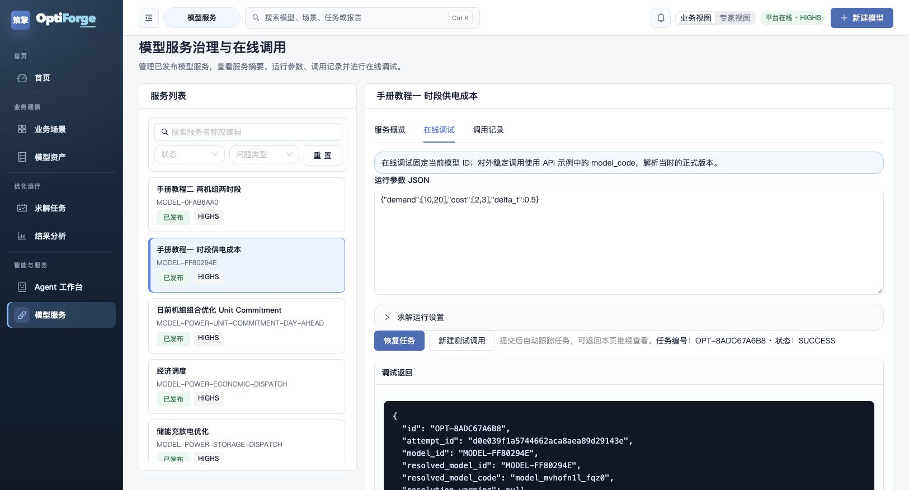

试运行模型不会自动进入正式模型服务。参数 JSON 是业务对象，复制 API 示例需另改实际服务器地址；不能把整份 HTTP 请求外壳贴进该参数框。

---

## 14. Skill 服务中心

入口：`/skills`。

Skill 是模型服务化后的可治理调用单元。服务中心可查看：

- Skill 总数、启用数和停用数。
- 绑定模型和模型版本。
- Agent 是否绑定。
- 输入/输出 Schema 字段数。
- 最近调用、成功率和失败数。
- 平均耗时和异常 Skill。

### 14.1 Skill 详情

详情页签包括：

- 基础信息：Skill 名称、模型、端点、执行策略和人工复核要求。
- 输入 Schema：参数编码、类型、必填性、单位和维度。
- 生成与结果解释：SkillDefinition、定义 Hash、修订、生成方式和校验状态。
- 输出 Schema：结构化输出契约。
- Agent 绑定：Agent Skill 包、版本、状态和语义质量信息。
- 调用记录：调用 ID、状态、耗时和时间。

### 14.2 Skill 治理操作

- 启用/停用：控制 Skill 是否可调用；停用后仍保留治理记录。
- 模型契约和 Schema：通过“生成/重新生成完整 Skill”统一刷新，固定绑定的 Skill 如果检测到模型契约 Hash 已变化，会提示先重新生成，避免调用旧定义。
- 生成完整 Skill：从当前模型契约生成输入、输出、参数采集问题、指标、风险规则和证据引用，并创建可版本化的 `SkillDefinition`。预览不持久化，正式生成会写入当前修订。
- 生成 Agent 包：基于当前完整 `SkillDefinition` 创建或更新 Agent Skill 包，包含 `SKILL.md`、Schema、提示词、适配器、示例和测试夹具。它只增加自然语言入口、参数收集和确认流程，不创建新的优化模型。生成后状态为“待启用”，需点击“启用 Agent”才会计入绑定；重新生成已启用包后也需要重新启用。
- 校验人工修改：校验手工编辑的 SkillDefinition JSON。
- 保存为新修订：保留修改历史，不直接覆盖旧修订。

### 14.3 Hash、修订与 Agent 生效关系

- 定义 Hash 是 `SkillDefinition` 的 SHA-256 内容指纹，用于判断定义是否一致、关联修订和追踪审计；它不是加密内容，也不是求解结果。
- Hash 计算会忽略自身 Hash、校验结果和生成时间；Schema、模型绑定、指标、阈值、解释规则或文案变化会产生新的 Hash。
- 模型契约 Hash 与定义 Hash 分开记录：模型契约 Hash 变化表示绑定模型的输入/输出契约发生变化，固定绑定的旧 Skill 需要重新生成。
- 新生成或人工修改的定义必须校验通过，Agent 包也必须通过目录、Schema、示例、提示词、适配器和安全策略校验，才能启用。
- Agent 调用链为“自然语言识别 → 参数收集 → 默认值/示例值确认 → 人工确认调用 → API Skill 求解 → 结果解释”。未确认或缺少必填参数时不会调用模型。

在线测试会执行真实 Skill。测试返回只用于辅助分析，不构成自动控制指令；高风险参数必须先人工复核。

<a id="144-教程六把已发布模型接入-skill-和-agent"></a>

### 14.4 教程六：把已发布模型接入 Skill 和 Agent

**目标和前置条件。**使用 8.2 已发布的一维模型，创建完整 SkillDefinition、Agent 包、启用绑定，真实 Skill 测试应得到 40。生成这些文件及直接 Skill 测试不需要 LLM；自然语言多轮对话另需支持 Function Calling 的真实 LLM。本轮验证到包启用及 Skill 测试，**没有配置真实凭证、没有宣称对话闭环通过**。

#### A. 固定模型与生成完整 Skill

1. 模型详情“基本信息”记下自己生成的模型 ID、编码、版本和“正式模型服务”中的 Skill 编码。实测为 `MODEL-FF80294E`、`model_mvhofn1l_fqz0`、v0.1、`run_model_mvhofn1l_fqz0`；用户新建的编码不同。
2. 全局专家视图 →“Skill 服务”，找到同编码行，核对绑定模型 ID / 版本、状态 `enabled`。发布产生的可调用 Skill 记录和“完整 SkillDefinition 已生成”是不同状态；看到“未生成”还要执行下一步。
3. 点该行“生成完整 Skill”，进入详情“生成与结果解释”，核对修订 1、validation valid、source_contract_hash、definition_hash。确定性契约生成可以在 LLM 关闭时完成。
4. “输入 Schema”应有 demand[time]、cost[time]、delta_t 标量；“输出 Schema”应有 p[time]。自动生成的采集问题应对应这三个输入，不应该出现 cap 或 U1 等另一个教程的数据。

#### B. 生成并启用 Agent 包

1. 同一详情“Agent 绑定”→“生成 Agent 包”。应看到 `has_agent_package=true`、`agent_package_status=draft`、validation valid，提示“Agent 已生成但尚未启用”。
2. 核对绑定的完整 Skill 修订及模型，再点“启用 Agent”。应看到 agent_enabled=true，列表显示绑定。自动语义质量分只是一项诊断；本轮该小模型为 61/100，不能当作自然语言场景覆盖率。
3. 后续重新生成包会回到待启用状态，需要再次启用并测试；不要只依据“目录存在”判断入口已可调用。

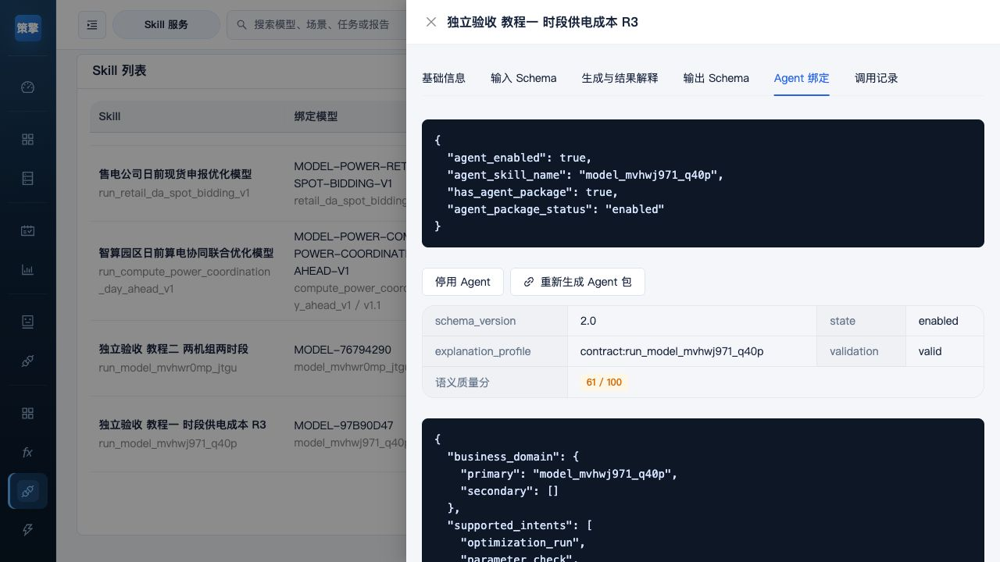

#### C. 不经 LLM 的真实 Skill 测试

1. 关闭详情，点击该行“测试”，打开“在线测试：你的 Skill 编码”。在“Skill 测试参数 JSON”填写：

~~~json
{"demand":[10,20],"cost":[2,3],"delta_t":0.5}
~~~

2. 点“运行测试”，这是执行真实模型。返回后检查求解 success、目标 40、p 最小 10 / 最大 20 / 总和 30；查看原始变量应为 `[10,20]`。可用 8.2 表再次复算，不能只读自然语言摘要。
3. 检查 explanation_audit 的 skill_definition_revision / hash 对应刚生成定义；原始返回的 constraint_checks 及 evidence_package.constraint_checks 应含两条需求检查，实际值10、20，下界10、20，违反量0。再按本教程手算。旧结果若没有原始数值证据，仍须保留缺少明细的限制，不能补成通过。
4. “调用记录”应增加本次调用。关闭、重开同 Skill，确认模型 ID、定义修订与 Agent 状态仍一致。

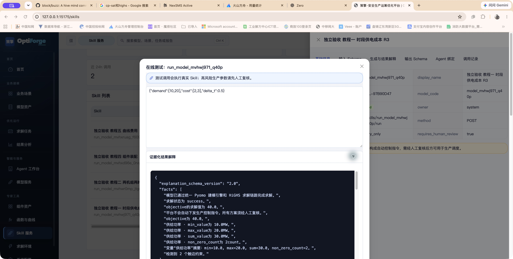

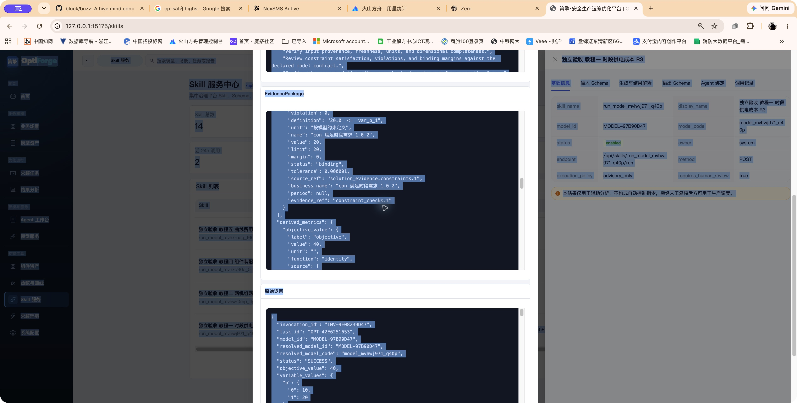

#### D. 真实 LLM 对话验收（部署后待执行）

1. 先按 16.3 保存真实 LLM 配置并“测试连接”，Function Calling 协议通过；再到 Agent 工作台新建会话。
2. 发送完整意图，例如：“调用手册教程一 时段供电成本。两个半小时时段，需求 [10,20] MW，成本 [2,3] 元/MWh，delta_t=0.5 小时，计算并解释结果。”
3. 若未匹配，明确选择同一模型 / Skill；检查参数收集卡中三个键及单位。缺值时按 15.4 的参数编辑 / 批量填写补齐。示例值或默认值需要按界面先确认采用，不能自动视为用户业务数据。
4. 在真实调用确认卡核对 Skill、模型版本、输入和求解设置，再明确确认执行。**写入对话不等于发送，默认值确认不等于执行确认。**未确认前不应出现真实求解任务。
5. 调用完成后核对真实任务 ID、目标 40、p=[10,20]；与直接 Skill 测试对应。保留会话、任务与版本证据，这一段才算闭环通过。

本轮未执行 D；LLM 关闭时停在环境前置条件，不能据此认定生成失败，也不能用模拟对话替代验收。

#### E. 升级后的检查顺序

按“目标模型版本 → 完整 Skill 定义 / 契约 Hash → Agent 包 → 启用状态 → 真实输入测试”逐层检查。同模型编码新正式版本发布后，按编码调用会切换，但既有**固定模型 ID 的 Skill**保留原绑定；先确认希望继续旧版还是建立新版绑定，再重生成契约与包。不要为了让历史结果跟随新曲线而覆盖旧定义。

---

## 15. Agent 工作台

入口：`/agents`。当前工作台支持一般对话、问题解释和调用运筹优化 Skill。自然语言工具调用需要可连接、支持 Function Calling 的 LLM，以及可用的模型与 Agent Skill。

### 15.1 使用前检查

| 顶部状态 | 含义 | 操作 |
| --- | --- | --- |
| 模型未配置 | LLM 未启用或配置不完整 | 到系统配置填写并保存接入 |
| 智能体可用 | 连接与工具能力已经验证 | 继续对话和调用 |
| Function Calling 待检查 | 工具调用能力尚未验证 | 在系统配置中测试连接 |
| 模型连接不稳定 | 连接退化或间歇失败 | 检查服务、网络和活动错误 |
| 模型服务不可用 | 当前模型请求失败 | 修复后重试本轮 |
| 模型服务恢复中 | 等待模型服务恢复 | 查看活动与可重试状态 |

Function Calling 状态属于大模型接入层，与某个优化模型的参数是否齐全是不同检查。未配置 LLM 时，仍可通过任务中心运行普通模型。

### 15.2 新建会话与发送消息

左侧“会话”支持“新建”、搜索标题或最近消息及切换历史记录。窄屏点击“会话”打开列表。

输入后点击“发送”，或按 Enter 发送，Shift+Enter 换行。首页示例按钮仅填入输入框，不会立即发起请求。一般知识问题可直接回答，不一定创建优化任务。

同一会话可以包含多轮消息与多个业务任务。某轮消息处理完成，不代表相应求解任务已经完成；查看活动中的具体任务状态。

### 15.3 描述需求与选择模型

建议说明目标、时间、对象和可用数据，例如：

```text
我需要制定明日机组组合计划，目标是降低运行成本。
请先列出负荷、机组容量、初始状态和启停等所需参数，
等我补齐并确认后再执行计算。
```

```text
我需要分析中长期合约分解与现货敞口，使用 96 点日前数据。
请先检查合约总量和暴露比例约束，并让我确认调用。
```

查看候选 Skill 或模型卡片，必要时点击候选继续。能够匹配的业务以当前启用并校验通过的 Agent Skill 为准。

### 15.4 补充与批量填写参数

1. 查看缺参提示中的名称、编码和单位。
2. 在对话中补充，或点击“批量补充参数”。
3. 可一次填写全部或部分缺失项。
4. 点击“写入对话”。
5. 在消息框复核，再点击“发送”。

“写入对话”只形成消息草稿，不会自动提交参数或开始求解；未填写项仍保留。切换模型或工作流后，重新核对当前参数和待确认内容。

### 15.5 默认值确认与真实调用确认

通常流程为：识别需求 → 选择 Skill → 收集参数 → 确认默认值或示例值 → 确认调用 → 求解 → 解释。

- “确认默认值”：确认当前草稿列出的默认值或示例值。
- “提交优化任务”：确认执行已经准备好的真实调用。
- “拒绝”：拒绝当前待确认操作。

只有存在对应待确认操作时才显示相关按钮。确认默认值后，继续检查是否仍缺必填值，以及是否需要确认调用。演示样例不能当作已经接入的真实预测。

### 15.6 活动与诊断信息

点击右上角“活动”，查看当前任务、阶段、参数准备、审批、执行和异常。点击“诊断信息”查看平台连通、路由、工具等细节，并可在可用列表中指定 Skill。

普通操作优先使用候选卡、缺参提示和确认按钮。内部运行 ID 用于排查，无需复制到自然语言消息才能继续任务。

### 15.7 重试取消与删除

- 某轮消息出现失败卡且可重试时，点击“重试本轮”；它与任务中心的原求解任务重试是不同操作。
- 当前业务任务处于运行、等待输入或确认等状态时，可在活动面板“取消任务”。
- 会话“更多 → 删除会话”会移除该会话关联运行记录，无法通过页面恢复。

连接中断时先查看本轮是否已记录，再使用失败记录上的重试入口，避免反复发送同一需求。

### 15.8 平台访问异常

`PLATFORM_UNAVAILABLE` 通常表示 Agent 侧无法访问平台。单体检查 `SERVICE_MODE=combined`、`AGENT_PLATFORM_ACCESS_MODE=in_process`；分体检查平台地址和连接。

模型和 Skill 输出用于辅助分析，最终采用应结合输入、约束与业务复核。

---

## 16. 求解环境与系统配置

### 16.1 求解运行环境

入口：`/runtime`。

可查看：

- 后端 API 是否连通。
- HiGHS 是否可用。
- Ipopt 是否可用。
- 任务服务是否连通。
- 当前前端入口和生产托管状态。
- 默认求解器与运行方式。

如果 Ipopt 不可用：

- LP/MILP/PWL/McCormick 任务仍可使用 HiGHS。
- NLP 模型不能假装成功，发布或运行会显示明确阻断信息。
- 可安装并配置 Ipopt，或把业务关系改为受支持的线性化策略。

### 16.2 系统配置

入口：`/settings`。

可维护内容包括：

- 服务连通性和状态总览。
- 业务场景字典。
- 组件领域和组件分类字典。
- 大模型 Provider、启用状态和连接测试。
- 部署入口和求解器配置说明。

修改业务场景字典后，模型创建页和业务场景库的可选项会随配置变化。没有启用任何业务场景时，空白建模流程不会回退到静态场景目录。

字典中可维护编码、名称、说明、启用与排序，业务场景另有状态，组件分类可关联领域。修改后点击“保存字典配置”。“恢复默认”会重置对应配置，执行前留存自定义内容。

### 16.3 配置大模型

当前 Provider 包括 `disabled`、`openai_compatible` 和 `volcengine_ark`。

1. 填写 Provider、Base URL、模型名或 Endpoint ID。
2. 填写 API Key，打开“启用大模型”。
3. 按需要设置 Temperature、Max Tokens 与超时秒数。
4. 点击“保存大模型配置”。
5. 保存成功后点击“测试连接”，检查 Function Calling 协议验证。
6. 返回 Agent 工作台查看服务状态。

测试使用后端当前保存的配置，仅在表单中修改而不保存，不会自动采用新值。网络可连通但工具验证未通过时，核对模型和 Provider 的工具调用协议。

已有 Key 时留空表示保留；需要清除时使用“清除已保存 Key”。前端不会回显明文 Key。也可由启动环境提供 `LLM_ENABLED`、`LLM_PROVIDER`、`LLM_BASE_URL`、`LLM_MODEL` 和 `LLM_API_KEY` 等变量。

本版新保存 Key 使用稳定 Secret 加密，迁移不再依赖新机器的主机名。优先使用部署提供的 `OPTIFORGE_CONFIG_SECRET`，其次读取 `OPTIFORGE_CONFIG_SECRET_FILE` 指定文件，否则使用运行时存储同目录隐藏文件 `.optiforge-config-secret`（首次保存时生成）。备份和迁移必须保留原 Secret / 原文件以及 runtime_store.json；生成另一个 Secret 不能恢复旧 Key。

设置页支持“从本机配置文件导入”。按界面显示的“本机配置文件”路径准备 JSON，填实际 provider / base_url / model / api_key 等配置后，明确点击导入，再测试连接。文件不在后台反复覆盖设置；后续编辑文件需要再次导入。默认文件是所选运行态目录下的 `llm.local.json`，可由 `OPTIFORGE_LLM_CONFIG_FILE` 指定。不要把含 Key 的本机文件、Secret 或运行数据提交到仓库。

旧版主机绑定 XOR 密文只在原环境材料仍可恢复时迁移；材料丢失应重新填写 Key，不能承诺找回。遇到“保存的 API Key 无法解密”时，先恢复保存时的同一 Secret / 文件，再测试；仍缺恢复材料则重新配置。旧密文会保留，不要通过清空数据目录处理。以上为本版实现核对，本轮未进行真实凭证迁移验收。

### 16.4 求解器与部署检查

端口和 API Base URL 等部署信息为只读，修改启动配置后需重启。Ipopt 的检测应确认可执行文件与 Pyomo 均可用；仅安装 `cyipopt` 不代表当前求解路径就绪。参见 [NLP 求解器说明](nlp-solver.md)。

---

## 17. 常见问题与故障处理

### 17.1 页面显示“平台连接异常”

检查：

~~~powershell
Invoke-RestMethod http://127.0.0.1:8000/api/health
~~~

如果失败：

1. 确认 FastAPI 进程正在运行。
2. 确认端口与前端 `VITE_API_BASE_URL` 一致。
3. 修改 `.env` 后重新启动 Vite。
4. 检查 `logs/` 中的后端错误日志。

### 17.2 模型、任务或结果列表为空

依次检查：

1. 后端是否以正确模式启动。
2. 是否打开了错误的端口或其他项目实例。
3. 是否切换到了会隐藏专家功能的业务视图。
4. 模型是否已发布；草稿和试运行模型不会作为正式调用模型使用。
5. 数据目录是否发生变化，原生模式和 Docker 模式的存储目录不同。

如果确认同一存储文件且只有派生模型消失，不要继续归咎于端口或视图。历史受影响版本存在派生资产持久化丢失问题，当前代码对派生模型族与来源关系作了修复，但不能重建已经丢掉的条目。立即备份现状与旧备份，留存版本号、原模型 ID、派生关系和发生时间，交开发判断可恢复范围；不要删除数据目录再试。此前“无自定义模型的部署副本迁移通过”也不能证明这类已丢派生资产已恢复。

### 17.3 提交任务按钮不可用

通常是以下原因之一：

- 没有选择模型。
- 模型契约仍在加载。
- 模型契约加载失败。
- 必填参数为空。
- 参数类型不合法。
- 时序数组长度不匹配 `horizon` 或 `time_volume`。
- 函数资产或组件引用无效。

打开参数问题抽屉，点击具体问题进入对应字段，不要只修改 JSON 中的一个字段后反复提交。

### 17.4 模型发布被阻断

检查“校验发布”中的阻断项：

- 基础信息是否完整、编码是否唯一。
- 集合、参数、变量是否完整。
- 公式是否编译成功。
- 组件依赖和参数绑定是否通过。
- 运行参数是否完整。
- 当前问题类型与 HiGHS/Ipopt 是否兼容。
- 测试通过后模型是否又被修改过。

### 17.5 任务无解或求解失败

优先查看任务详情中的“任务概览”“求解过程”和“技术日志”。常见原因包括：

- 负荷超过所有资源的出力上限。
- 初始状态或终端状态与边界冲突。
- 上下界方向或单位填写错误。
- 约束时间维度少一项或多一项。
- 函数资产点重复、曲线不完整或二维三角形无效。
- NLP 缺少 Ipopt、初值或变量上下界。

输入变化时创建新任务；原任务重试复用原请求。无解 `INFEASIBLE` 当前不接受原任务重试，应先修正后重新创建。

### 17.6 `PLATFORM_UNAVAILABLE`

单体 Agent/Skill 模式应使用：

~~~powershell
$env:SERVICE_MODE='combined'
$env:OPTIMIZATION_PLATFORM_BASE_URL='http://127.0.0.1:8000'
$env:AGENT_PLATFORM_ACCESS_MODE='in_process'
$env:AGENT_ALLOW_IN_PROCESS_PLATFORM_FALLBACK='false'
~~~

确认后端确实包含 Agent 和 Skill API，并重新创建会话或刷新页面。

### 17.7 Ipopt 不可用

打开 `/runtime` 查看 Ipopt 状态，或执行：

~~~powershell
python scripts/check_nlp_solver.py
~~~

如果只需要运行 LP/MILP，可以继续使用 HiGHS；如果必须运行 NLP，需要安装并配置 Ipopt，确认 Pyomo 能找到对应可执行文件。

### 17.8 二维 PWL 规模过大

二维精确 MILP 会按照时间点、设备数量和三角形数量扩展二进制选择变量。出现规模告警时，可考虑：

- 缩短调度时域。
- 减少网格点或三角形数量。
- 使用合理的函数资产和上下界。
- 评估非精确凸组合或 McCormick 策略是否满足业务精度。

### 17.9 生产模式刷新子路由返回 404

请先构建前端，再用 `server.py` 启动 FastAPI 托管模式：

~~~powershell
cd frontend
npm run build
cd ..
$env:SERVICE_MODE='combined'
$env:PORT='8000'
python server.py
~~~

开发模式下应通过 Vite 地址访问；生产模式下应通过 FastAPI 地址访问。

### 17.10 其他常见问题速查

| 现象 | 处理路径 |
| --- | --- |
| 手工启动后 8000 无响应 | 检查 `PORT`，未设时 `server.py` 可能运行在 8090 |
| CSV 出现非数字错误 | 任务参数用纯值网格，去掉表头、单位与千位分隔符 |
| 历史任务不能载入 | 检查是否成功、模型兼容以及周期一致 |
| 公式可见但未生效 | 检查参与求解状态、后端编译和组件执行能力 |
| 无解任务重试被拒绝 | 当前后端状态限制，修正后新建任务 |
| Function Calling 待检查 | 保存 LLM 配置后测试连接，核对工具调用协议 |
| Agent 包生成后不可用 | 在“Agent 绑定”中检查校验并点击“启用 Agent” |
| 批量参数填写后没变化 | “写入对话”后还需要复核并发送消息 |
| 没有某个专题结果页签 | 查看当前结果能力和原始 JSON，不要求所有模型同页签 |
| 重启后数据不同 | 核对端口、实例、数据目录；确认同存储仍缺派生资产时按 17.2 的历史产品缺陷处理并保留备份 |
| 迁移后 Key 不可用 | 重新配置凭证并测试连接 |

反馈问题时，提供页面路径、模型 ID 与版本、任务或调用 ID、发生时间、错误文字及去除凭证后的参数片段。数据较大时保留原始文件，便于检查完整结构。

---

### 17.11 按错误现象逐步修复

下列注明“UI 实测”的文字来自本轮界面；“实现核对”来自当前版本错误定义，未冒充逐条 UI 复现。交接时始终带上本手册提交号、模型 ID、任务 ID（如已生成）、输入和当前步骤；不要附明文凭证。

| 看到什么 / 在哪里 | 含义与类别 | 到哪里改、错误 → 正确 | 怎样确认恢复；何时交接 |
| --- | --- | --- | --- |
| `集合必须包含非空字符串或有限数字成员`，第二步集合弹窗，UI 实测 | 成员输入错误；规模不能替代真实成员 | 编辑机组 → 集合成员：`[]` → `["U1","U2"]`，保存 | 再开成员仍为两项，公式重新编译通过；仍拒绝保存时保留原输入和提示 |
| `集合成员不得为空或重复`，同弹窗，实现核对 | 编码有空值或重复，含数值 / 字符串编码冲突 | `["U1","U1"]` → `["U1","U2"]`；同步参数键 | 保存成功且第二步每个业务实体唯一；不是通过改默认规模解决 |
| `缺少必填运行参数`，第四步，实现核对 | 模型已声明参数但本次没有可用值 | 当前值栏为空 → 填 `unit_cost=2`；数组按两个时段填 `[10,20]`，按 Enter / 移出输入框 | 参数表不再“缺失”，最终结构预览出现数值；若导入提示成功但预览未变化，逐字段提交并保留前后截图 |
| `无法编译未知符号 …。` / FORMULA_SYMBOL_UNKNOWN，公式编译，实现核对 | 公式符号没有定义或编码不同 | 在本教程中 `load[t]` → `demand[t]`；或先在第二步正式声明对应参数 | 后端编译成功、应用后整体编译通过；不可只在运行 JSON 临时塞 load |
| 数组长度 / 轴或参数格式检查不通过，任务参数区 | 运行数据不符合当前契约 | 2 时段需求 `[10]` → `[10,20]`；`cap` 的 U2 `[4]` → `[4,6]`；维度 `unit,time` 时按行机组、列时间 | 参数问题清零，提交预览仍是正确轴顺序；维度看似合法但物理取值错时人工复算四个坐标 |
| `机组可用状态（availability）[S1_U1]时间维长度应为 4，当前为 3`，水电任务参数检查，R4独立UI复验 | 已定位缺少时段的机组行，不能提交 | 点“前往处理”找到availability。本例其他行均为默认值，点该参数“恢复原值”，S1_U1从`[1,1,1]`恢复为`[1,1,1,1]`。有自定义业务数据时只补齐该行缺少的时段并核对其他行，整项恢复会替换该参数的自定义值 | 问题计数变为0，S1_U1的T4显示1；点“检查并提交”，预览显示“参数检查通过，可以提交求解”。本次只验证恢复到可提交，未提交水电任务 |
| `'<=' not supported between instances of 'VarData' and 'str'`，组件校验，R2 历史问题 | 数值默认值或运行输入是字符串 | 在草稿对应默认值栏将 `"[15,25]"` 改为 `[15,25]`、`"2"` 改为 `2`；保存，核对模型本次输入同样为数字 | 重新执行校验通过；已发布组件用新修订，不删除旧资产 |
| `模型在测试通过后发生了修改，请重新测试后再发布。` / MODEL_TEST_OUTDATED，发布，实现核对 | 当前内容与测试凭据不同，属于治理阻断 | 继续保存当前草稿 → 回第五步重新测试，不覆盖 Hash 或测试记录 | 当前模型 ID / Hash 对应的新测试 SUCCESS 后才发布；无修改仍重复出现则交开发 |
| 测试后底部一直“待自动保存”，离开反复提示“保存期间有新的修改”，独立代理首次发现并复验修复 | 相同内容的保存确认缺失，本轮已修复 | 测试结束核对“已保存 / 最近测试通过”；有真实编辑时点击保存后再离开 | 同ID重开仍为试运行且测试记录保留；无编辑仍重复失败时保留ID / 截图交开发，不反复点击或删除草稿 |
| `SUCCESS` 但需求不满足或目标 0，任务结果 | 结果不符合业务，必须停发；R2 转换缺陷已修复 | 第三步确认需求和费用目标为 solve_active、已编译应用，再保存、重新测试当前草稿 | p=[10,20]、fee=[20,60]、目标40及约束均正确；仍异常则附当前 ID / 输入交开发 |
| 后端测试失败，组件模型第五步 | 本地检查完成仍需真实求解；失败面板展示后端原因 | 按字段与修复建议回第二步接口 / 绑定、第三步公式或第四步数值修改，保存并重新测试 | 正确目标20、p=[10,10]及边界复算通过后发布；只有通用错误而没有详情时保留 ID / 截图交开发 |
| `TASK_HISTORY_UNREPLAYABLE`，历史重算，实现核对 | 缺完整历史定义或执行快照，不是简单任务失败 | 保留原结果；恢复可信备份，或明确选择当前模型 / 修订建立新任务 | 新任务标明当前计算，不改写历史结果；缺原材料交管理员，不能承诺原环境复现 |
| `保存的 API Key 无法解密。…`，大模型配置，实现核对 | 加密恢复材料缺失或不一致，环境 / 迁移问题 | 恢复原 OPTIFORGE_CONFIG_SECRET 或 Secret 文件；无原材料时重新填 Key | 保存后测试连接且 Function Calling 通过；新随机 Secret 不能证明旧 Key 已恢复 |

不可行条件的恢复例：8.3 中需求 `[6,11]`、容量仍为 `[8,10]`，第二时段短缺 1 MW。保持数据真实性，调整可用容量、需求方案或业务约束后创建新任务；不能把需求改小只为让测试“通过”而继续用于原业务。

结果差异的处理顺序为“确认本次最终输入 → 手算关键坐标与时长 → 确认公式参与、Builder 与依赖 → 记录差异”。系统缺约束明细时明确说明证据不足，业务不成立的结果即使状态 SUCCESS 也不得通过验收。

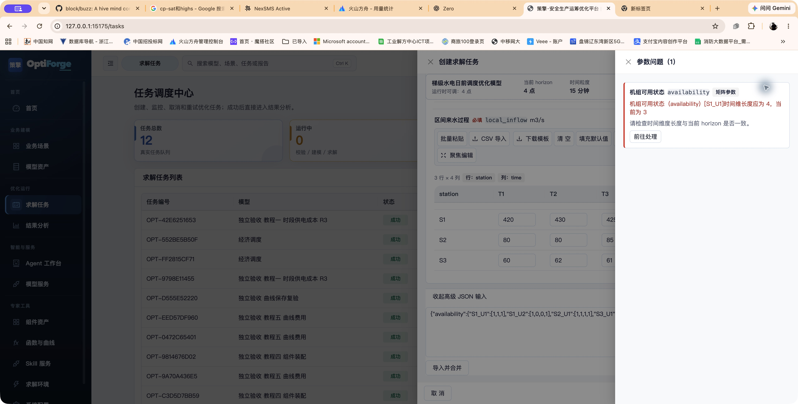


## 18. 推荐操作清单与能力边界

### 18.1 业务用户提交任务前

- [ ] 模型状态为已发布或当前允许调用状态。
- [ ] 调度周期和时间分辨率符合业务要求。
- [ ] 必填时序参数长度与时间维度一致。
- [ ] 输入数据单位、时间区间和版本已确认。
- [ ] 初始状态、终端状态和边界参数已复核。
- [ ] 提交前已阅读参数问题抽屉和 JSON 预览。

### 18.2 建模工程师发布前

- [ ] 模型编码唯一且稳定。
- [ ] 集合、参数、变量、单位和维度有完整说明。
- [ ] 公式已通过后端权威编译。
- [ ] 所有组件依赖和函数资产已校验。
- [ ] 运行参数 Schema 与示例值可复现一次真实任务。
- [ ] 已完成 dry-run 和测试运行。
- [ ] 测试通过后没有未重新测试的改动。
- [ ] 已确认问题类型、求解器和非线性处理策略。

### 18.3 结果复核时

- [ ] 检查任务状态和终止状态。
- [ ] 检查约束违反摘要。
- [ ] 检查关键变量曲线和边界是否合理。
- [ ] 检查目标函数的业务含义，不跨模型直接比较数值。
- [ ] NLP 结果确认局部最优风险。
- [ ] 水电、储能等模型确认库容、SOC、出力和守恒关系。
- [ ] 记录人工复核结论后再用于业务计划。

### 18.4 当前版本边界

- 结果导出按钮仍是预留能力，不作为主流程功能承诺。
- 展示公式、编辑提示和实际求解能力分别检查，所需规则必须参与求解。
- Agent 和 Skill 的结果必须人工复核，不自动形成控制指令。
- MINLP 不作为生产级求解能力开放。
- NLP 的 Ipopt 结果不承诺全局最优。
- 正式功能以 `frontend/` 的 React/Vite 页面为准。
- 样例和模拟预测不等于已连接生产业务系统。
- 时间周期按各模型契约处理，固定模型不能在任务中任意改点数。
- 后端滚动与容量比较主要通过 API 提供，留档与计算口径需分别检查。

### 18.5 本轮修复与仍需保留的边界

| 编号 | 发现的问题 | 本轮处理及检查方法 |
| --- | --- | --- |
| M-01 | 时间自由索引与集合名重复，2 点预估 4 条 | 修正别名收集与兼容 scope；一维约束 / 目标应分别为 2 条 / 2 项，二维容量为 4 条 |
| M-02 | 组件默认值数字 / 数组保存成文本 | 默认值和示例值解析 JSON；空白不设置、0 保留；重新打开检查，执行校验通过 |
| M-03 | 通用→组件化后需求与目标未进入求解 | 启用模型自有公式与组件一起执行；无效公式必须阻断；曲线 r1 核对目标40与两时段需求 |
| M-04 | 动态目标不被识别、不同编码绑定、变量下界漏读，整体422 | 服务端确认已编译目标；保留参数映射；读取模型上下界；装配结果20、p=[10,10]并发布 |
| M-07 | 组件审计重复、绿勾被理解为后端通过、错误只显示422 | 优先一套规范公式字段；本地检查与后端测试分别提示；错误展示字段 / 建议；绑定抽屉说明检查范围 |
| M-08 | 测试与发布可能使用不同规范化定义 | 测试保存实际执行定义，发布检查相同内容；重新上架保留不可变历史定义 |
| M-09 | 独立代理发现：编译推断 t→time 成功，保存却把 foreach 的 t 当作集合 | 编译后保存真实集合 time 与别名 t；服务端兼容明确 scope；独立代理已复验一维 / 二维保存、测试和发布 |
| M-10 | 独立代理发现：已发布通用模型详情“原始 DSL”显示为“-” | 依据编译产物的 source_formula_id 关联冻结源表达式；独立代理已在二维模型重开确认三条原文显示 |
| M-11 | 独立代理发现：曲线测试后重复提示未保存，保存并离开失败 | 相同内容的保存也确认已保存状态，保留真正的新修改；独立代理已复验测试后正常保存、离开和同ID重开 |
| M-12 | 水电错误输入被通用校验提前拦截，首条提示缺业务中文 | 保留结构化字段、期望和实际长度，同时使用模型声明的水电前缀及机组称谓；原两项测试通过 |
| M-13 | 任务概览诊断为空，Skill解释层没有接入已有约束残差 | 统一从实际求解证据生成摘要及逐条数值，任务概览、结果报告、Skill / Agent共用；无证据仍标未知，部分缺数值标未完成检查 |
| M-14 | 版本切换回归缺运行输入，未执行到切换断言 | 用例显式填写负荷、成本、最大出力，真实发布两版并分别由Skill / Agent网关求解，核对新模型ID与目标3800 |
| M-15 | R4独立复验：矩阵时间长度错误缺机组行定位，本地只采样首行 | 检查所有时间切片，提示具体坐标，如availability的[S1_U1]；非首行映射 / 数组、三维状态序列及修复恢复均有回归覆盖 |

R3修复与独立UI验收见 [R3记录](manual-repair-acceptance-2026-10-21.md)及 [R3代理验收报告](independent-ui-acceptance-2026-10-21.md)；M-12～M-15的源码指纹、工程回归和独立复验见 [R4遗留项记录](manual-followup-closure-2026-10-21.md)。源码 / API 回归与独立UI操作分别留证。

历史受影响版本的派生资产若已丢失，本次修复不能凭空恢复；先保留备份、核对资产 ID、模型族及来源。完整原环境恢复系统仍未建设，当前内核历史输入重算不得宣传为严格原环境重放。

当前 QP / MIQP 的类型识别不代表原生求解已开放；不能通过改名称、舍入连续解或用近似 PWL 宣称原生支持。实际能力按本版求解路由与兼容检查确定。

### 18.6 独立操作验收表

**R3状态：六条主教程的独立代理界面验收已完成。**用户选择的测试代理未参与修复，只获得本手册和隔离环境地址，不看源码、不使用 API / 运行库补数据、不接受作者即时操作指导。它属于代理验收，不能称为真实业务用户或第三方人工验收。详细过程及首次故障、修复后复验见 [R3代理验收报告](independent-ui-acceptance-2026-10-21.md)。R4针对遗留错误提示、结果明细及版本治理的工程与独立复验单独记录在 [R4修复与复验](manual-followup-closure-2026-10-21.md)。

| 项目 | 必须保留的证据 | 通过标准 | 当前状态 |
| --- | --- | --- | --- |
| 已有模型调用 | 最终输入、任务、出力与费用表 | 目标160300，平衡 / 上下界 / 爬坡复算一致 | R3 独立代理通过 |
| 空白一维 | 草稿 / 发布 ID、参数预览、任务结果 | p=[10,20]、目标40、发布后可重开 | R3 独立代理通过 |
| 空白二维 | 两集合成员、四坐标、任务结果 | p=[[4,4],[2,4]]、目标17，发布后可重开 | R3 独立代理通过 |
| 故意空集合再修正 | 错误截图、修改输入、重新保存 | 只按手册能从 [] 改成真实成员并继续 | R3 独立代理通过 |
| 组件装配 | 接口、不同编码映射、数值、发布 ID | 组件及模型均可求解、核算、发布 / 重开 | R3 独立代理通过，目标20 |
| 曲线与修订更新 | r1 / r2、固定绑定、候选比较、旧任务 | 曲线参与；更新范围正确；旧 ID / 历史保留 | R3 独立代理通过：40→55，旧r1/历史40保留 |
| Skill / Agent | 模型版本、定义修订、包启用、对话和真实任务 | 参数收集、默认确认、执行确认和结果均一致 | 完整定义 / Agent包 / 直接Skill已独立通过；真实LLM对话未验收 |
| 状态递推 | 状态成员、初末式、递推残差 | energy=[0,5,15]，无边界遗漏 | 练习未实测 |
| 重启 / 迁移 | 前后资产清单、族与来源、密钥恢复 | 自定义派生模型 / 依赖不丢；凭证可恢复 | 本轮未执行 |

**R4遗留项复验。**独立测试代理通过界面新建经济调度任务，确认目标160300、40条约束0违反及报告逐条明细；真实Skill调用目标40，原始返回与解释证据均有两条需求数值；水电availability错误输入修复后明确定位[S1_U1]，补齐后问题0并恢复到可提交。版本项核对已有v0.2正式服务、v0.1历史下线及既有固定Skill信息，未在本轮UI重新发布版本；动态切换的执行证据来自真实Skill / Agent工程回归。详见 [R4代理报告](independent-ui-acceptance-followup-2026-10-21.md)及 [修复与测试](manual-followup-closure-2026-10-21.md)。

每次停住填写：步骤编号、屏幕反馈、已经填入的值、是否必须问作者、是否需要后台动作、恢复后结果。需要即时指导或后台补值的教程不得判为独立通过；产品缺陷单独立项，不能记为学习者失败。已知限制被正确识别为产品限制也是验收内容，但不替代对应业务教程的通过。

---

## 19. 典型场景操作要点

### 19.1 机组组合与经济调度

机组组合重点检查负荷、备用、机组出力上下限、初始启停状态、连续开停机时长、爬坡及启停成本。经济调度侧重已有机组条件下的经济出力分配，两者应使用各自 Schema。

结果核对启停计划、出力、负荷平衡和备用。样例通过后分组替换真实数据，便于定位哪项输入导致不可行。

### 19.2 储能与光储日前调度

1. 准备电价、新能源预测、并网限制和计划曲线。
2. 核对储能功率容量与能量容量。
3. 检查初始 SOC、上下界、效率和期末目标。
4. V2 还需检查充放电互斥、偏差限值和考核成本。
5. 求解后复核 SOC、充放电、弃光、偏差与收益分项。

不同模型的 SOC 可能表示能量或比例，按所选模型单位填写，不能把 50 MWh 与 50% 互换。

### 19.3 光储日内滚动

普通任务向导执行单个时域。需要多轮移动窗口和 SOC 传递时，使用后端滚动服务，不能仅在普通任务参数中加入 `rounds`。

输入当前 SOC、更新预测、窗口、步长和轮数，序列应覆盖全部窗口。逐轮核对执行段、后续 SOC 和失败原因。执行段是模拟或计划选取，不代表已经下发实际设备控制。接口见第 21 章。

### 19.4 梯级水电与 NLP

核对电站机组编码、上下游关系、传播时滞、来水、初末库容、下泄、生态流量、检修容量和负荷跟踪。PWL 模型还要核对曲线与曲面 ID、定义域和求解策略。

结果复核水量平衡、库容轨迹、出力与弃水。NLP 试点另需确认 Ipopt、初值、边界、终止条件及局部最优风险。

参见 [水电演示指南](demo-cascade-hydro-guide.md) 与 [NLP 演示指南](demo-nlp-ipopt-guide.md)。

### 19.5 合约分解与日前申报

当前市场模板采用固定 96 点契约。保持同一交易日、时段顺序和电量价格口径，按 `delta_t` 处理功率与电量转换。

合约分解核对负荷、合约总量、合约价格、现货价格、暴露上限和罚项。日前申报还包括储能、可调负荷、申报上下限及偏差成本。

结果复核合约总量、暴露比例、申报量、SOC、负荷转移守恒和短缺富余偏差。输出为建议，不会直接报送交易平台。

### 19.6 智算园区算电协同

使用 `compute_power_coordination_day_ahead_v1`，固定 24 点、每点 1 小时。单次 MILP 联合决定任务执行、GPU 集群状态、用电、光伏、储能和购电。

| 分组 | 主要数据 |
| --- | --- |
| 任务与 SLA | `work_arrival`、`initial_backlog`、`allowed_backlog`、`slack_limit`、`sla_penalty` |
| 集群资源 | `cluster_compatibility`、`gpu_capacity`、`initial_cluster_status`、`cluster_start_cost` |
| 功率转换 | `idle_power`、`gpu_dynamic_power`、`pue`、`facility_aux_load` |
| 能源 | `pv_forecast`、`electricity_price`、`grid_power_limit`、碳排放相关参数 |
| 储能与目标 | 功率和能量容量、SOC、效率、终值目标与 `weights` |

对象编码与 `workload`、`cluster` 一致，多维参数保持 Schema 指定结构。时段数据检查 24 点，状态时点按 25 点契约检查。

结果重点看任务执行与积压、GPU 占用、集群状态、功率平衡、购电峰值、光伏利用和 SOC。当前面向单园区聚合任务池，不包含跨园区迁移或自动控制下发。

---

## 20. 数据备份与部署维护

### 20.1 数据位置

| 内容 | 原生默认位置 | Docker 主机位置 |
| --- | --- | --- |
| 模型、任务、结果、配置与审计 | `data/runtime_store.json` | `docker-data/runtime_store.json` |
| Agent Skill 包 | `agent_skills/` 或指定目录 | `docker-data/agent_skills/` |
| LLM 加密 Secret | 运行时存储同目录 `.optiforge-config-secret`，或显式环境 / 文件 | 默认 `docker-data/.optiforge-config-secret`，或显式配置材料 |
| shell 启动日志 | `logs/` | 主要使用 Compose 日志 |
| 报告导出文件 | 项目 `reports/` | 容器 `/app/reports/`，当前没有单独持久化挂载 |
| 视图偏好及通知处理标记 | 浏览器本地存储 | 浏览器本地存储 |

实际路径可由 `OPTIFORGE_RUNTIME_STORE`、`RUNTIME_STORE_PATH`、`OPTIFORGE_AGENT_SKILLS_DIR` 等覆盖。原生与 Docker 默认不共享记录。

### 20.2 原生备份

等待重要任务完成并停止服务，再备份一致快照。macOS/Linux 示例：

```bash
./stop.sh
backup_dir="backups/$(date +%Y%m%d-%H%M%S)"
mkdir -p "$backup_dir"
cp -R data "$backup_dir/data"
cp -R agent_skills "$backup_dir/agent_skills"
```

需要留存的报告另行复制。`cp -R data` 会包含该目录中的隐藏 Secret；如果 Secret 使用环境变量或外部文件，须另外保留**原值 / 原文件**，上述命令不会自动备份它。自定义目录使用实际路径，备份包含业务数据和配置，应存放在合适的位置。

### 20.3 Docker 备份

```bash
docker compose stop
backup_dir="backups/docker-$(date +%Y%m%d-%H%M%S)"
mkdir -p "$backup_dir"
cp -R docker-data "$backup_dir/docker-data"
docker compose start
```

容器内导出报告在重建前应复制出来，或单独配置报告目录持久化挂载。

### 20.4 恢复与迁移

1. 停止目标服务，备份目标现有数据。
2. 将备份还原到实际使用的数据和 Agent 包目录；同时还原同一加密 Secret，显式环境变量 / 外部文件也要恢复原材料。
3. 检查访问权限、环境变量与路径。
4. 启动并等待加载及必要的格式迁移。
5. 检查模型版本、任务结果、Skill 和 Agent 状态。
6. 大模型配置核对 Secret 恢复状态并测试连接；求解器运行样例验证。先对比迁移前后模型 ID、模型族、派生关系和依赖数量，不只比较任务数。

不要在服务运行时手工编辑或覆盖运行时 JSON。升级前保留原始备份，不通过删除数据目录处理普通界面问题。

### 20.5 日志

```text
logs/react-stack-api.stdout.log
logs/react-stack-api.stderr.log
logs/react-stack-frontend.stdout.log
logs/react-stack-frontend.stderr.log
```

启动失败先查服务日志，单任务失败查对应输入与技术日志，Agent 消息失败查失败卡和活动诊断。

---

## 21. API 集成与高级功能

交互式接口文档位于后端 `/docs`。请求字段以当前 OpenAPI 和模型契约为准。

### 21.1 常用接口

| 用途 | 方法与路径 |
| --- | --- |
| 状态 | `GET /api/health`、`GET /api/solvers/status` |
| 模板与样例 | `GET /api/templates`、`GET /api/templates/{code}/sample-runtime-parameters` |
| 模型详情与契约 | `GET /api/models`、`GET /api/models/{id}`、`GET /api/models/{id}/schema` |
| 资产详情 | `GET /api/models/{id}/asset-detail` |
| 测试发布 | `POST /api/models/{id}/test`、`POST /api/models/{id}/publish`、`POST /api/models/{id}/offline` |
| 创建查询任务 | `POST /api/tasks`、`GET /api/tasks/{id}` |
| 取消重试删除 | `POST /api/tasks/{id}/cancel`、`POST /api/tasks/{id}/retry`、`DELETE /api/tasks/{id}` |
| 结果 | `GET /api/results`、`GET /api/tasks/{id}/result` |
| API Skill | `GET /api/skills`、`POST /api/skills/{name}/run` |
| 调用详情 | `GET /api/invocations/{id}` |
| Agent | `GET /api/agent/status`、`GET /api/agent/conversations` |
| 报告 | `POST /api/reports/export` |

### 21.2 创建异步任务

以下可保存为 `task-request.json`，运行第 5 章的经济调度样例。按编码调用要求存在正式发布版本。

```json
{
  "model_code": "economic_dispatch",
  "horizon": 4,
  "solver": "auto",
  "async_run": true,
  "time_limit_seconds": 300,
  "runtime_parameters": {
    "unit": ["U1", "U2", "U3"],
    "load_forecast": [160, 190, 175, 150],
    "unit_min_output": {"U1": 30, "U2": 20, "U3": 10},
    "unit_max_output": {"U1": 120, "U2": 90, "U3": 70},
    "fuel_cost": {"U1": 220, "U2": 260, "U3": 360},
    "ramp_up_limit": {"U1": 80, "U2": 60, "U3": 50},
    "ramp_down_limit": {"U1": 80, "U2": 60, "U3": 50},
    "initial_unit_output": {"U1": 80, "U2": 50, "U3": 30}
  }
}
```

```bash
curl -X POST http://127.0.0.1:8000/api/tasks \
  -H 'Content-Type: application/json' \
  --data-binary @task-request.json
```

固定具体版本时使用从模型接口读取的 `model_id`。当前 `runtime_parameters` 与 `parameters` 同名键以 `runtime_parameters` 为准，集成时宜统一一种容器，避免歧义。

`async_run: true` 返回记录后继续查询，`false` 在请求中等待执行。创建成功不等于求解成功，应等到终态并核对结果。

### 21.3 查询与留档

把 `OPT-实际任务编号` 替换为返回的 `id`：

```bash
curl http://127.0.0.1:8000/api/tasks/OPT-实际任务编号
curl http://127.0.0.1:8000/api/tasks/OPT-实际任务编号/result \
  -o solve-result.json
```

保留实际模型 ID、输入、状态、求解器、终止条件、结果与人工复核结论。按 `model_code` 路由时也应记录最终解析到的版本。

### 21.4 生成后端报告

请求 `POST /api/reports/export` 的结构如下。空对象是占位，需要替换成实际输入和求解结果；该接口不会只凭场景名或任务编号补齐内容。

```json
{
  "scenario": "economic_dispatch",
  "forecast_inputs": {},
  "solve_result": {},
  "business_summary": "",
  "warnings": [],
  "format": "html"
}
```

返回 `download_url`，拼接后端地址访问。`format: "word"` 写出 HTML 格式 `.doc`；原生 `.docx` 或 PDF 需使用相应文档生成流程。

### 21.5 滚动调度

```text
POST /api/rolling/run
GET  /api/rolling/{rolling_job_id}
GET  /api/rolling/{rolling_job_id}/history
POST /api/pv-storage/dispatch/intraday/rolling-run
GET  /api/pv-storage/dispatch/intraday/{rolling_job_id}
GET  /api/pv-storage/dispatch/intraday/{rolling_job_id}/history
```

通用请求包含 `model_template_code`、可选 `model_id`、`horizon`、`step_size`、`rounds` 和 `runtime_parameters`。步长不能大于窗口长度。

光储专用请求使用 `rolling_horizon`、`execution_step`、`rounds`、`current_soc`、`time_step_hours` 及预测、价格、计划和限制序列。按编码调用需要正式发布版本，试运行验收显式指定 ID。

滚动服务固定本次模型版本，并把每轮执行段后的 SOC 传递到下一轮。逐轮检查状态、失败原因和历史；当前汇总存在运行进程内，需要留档时主动保存，不能假设重启后仍保留汇总。

### 21.6 候选容量轻量对比

`POST /api/pv-storage/sizing/compare-lite` 接收候选储能功率与能量容量、场景参数、成本和年化参数。

检查方案可行性、SOC 调整记录及年化收益成本口径。当前为轻量比较，样例回收期不应直接用于正式投资判断；前端没有独立完整的对比向导。

---

## 22. 术语与延伸资料

| 术语 | 含义 |
| --- | --- |
| 业务场景 | 对业务问题的分类，用于组织模型和建模入口 |
| 模型模板 | 创建模型时复用的定义和样例，不是每次计算的任务 |
| 模型资产 | 保存到平台并具有状态和版本的模型 |
| 组件资产 | 可复用的集合接口、变量、约束、目标项和依赖 |
| 函数资产 | 可供预览和模型映射使用的曲线或曲面及求解策略 |
| 求解任务 | 使用某一模型版本和一份输入执行的一次计算 |
| API Skill | 封装模型调用、参数契约和解释规则的服务单元 |
| Agent Skill 包 | 为 API Skill 增加意图、参数收集、提示词和适配器的包 |
| Schema 或契约 | 输入输出的字段、类型、维度、单位和约束说明 |
| Builder | 将模型定义构建为求解模型的路径 |
| `model_code` | 模型族的稳定识别编码 |
| `model_id` | 某个具体模型资产或版本的标识 |
| `horizon` | 调度时段点数 |
| `delta_t` | 模型中每个时段的时间长度，通常以小时表示 |
| SOC | 储能状态，按具体模型解释为能量或比例 |
| PWL | 分段线性表达 |
| Gap | 相应求解路径中可行解与界的差距 |
| dry-run | 结构、构建与求解兼容性的试检 |
| Function Calling | 大模型按协议请求调用工具的能力 |
| EvidencePackage | 结果解释引用的事实与证据集合 |

进一步查阅：[项目启动说明](../README.md)、[部署说明](deployment.md)、[组件建模指南](component_builder_user_guide.md)、[函数与 PWL](function-assets-piecewise-guide.md)、[非线性能力边界](nonlinear-capability-boundary.md)、[Skill 生成与解释](skill_generation_and_explainability.md)。
